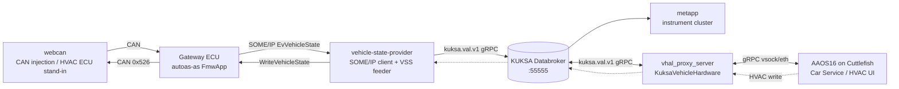
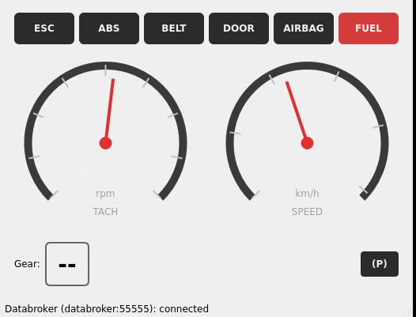

# auto-as-linux-android

A learning-oriented mini Cockpit Domain Controller (CDC). It follows vehicle data from a simulated CAN bus, through an AUTOSAR Gateway ECU and a Linux vehicle-state stack (SOME/IP and KUKSA), up to an instrument cluster app and the Vehicle HAL (VHAL) of Android Automotive OS 16 (AAOS16), and carries HVAC operations back the other way.

## Architecture



Vehicle state (speed, rpm, gear, doors, fuel, HVAC, ...) flows left to right. An HVAC operation in AAOS flows back as a KUKSA actuator target, a SOME/IP `WriteVehicleState`, and a CAN `AirconCommand` (0x526). webcan stands in for the missing HVAC ECU and answers with an `Aircon` state frame (0x323), which flows to the screen again.

## Repository layout

| Path | Contents |
|---|---|
| [auto-as-linux/](auto-as-linux/) | Docker Compose stack: Gateway ECU (`autoas-as/`), KUKSA Databroker and provider (`automotive_linux/`), `metapp/` |
| [aaos16/](aaos16/) | AAOS16 / Cuttlefish build environment, the KUKSA VHAL patch (`patches/`), and the end-to-end test (`tests/`) |
| [specs/](specs/) | System requirements, software requirements, software architecture and interface definitions |
| [docs/](docs/) | Plan, progress log, and manual check procedure |
| [thinking_logs/](thinking_logs/) | Summaries of agent sessions |

## Prerequisites

- Linux host with Docker (Compose v2) and KVM (`/dev/kvm`) for Cuttlefish. The AAOS16 build was done on 16 cores and 64 GiB of memory; the AOSP source tree needs roughly 300 GB of disk.
- Network access for `repo sync` and the Docker image builds.

## Build

### 1. KUKSA stack (Gateway ECU, Databroker, provider, metapp)

```bash
cd auto-as-linux
docker compose build
```

The first build is slow (the Gateway ECU, the vSOMEIP provider and the Databroker are built from source). Details: [auto-as-linux/README.md](auto-as-linux/README.md).

### 2. AAOS16 with the KUKSA VHAL bridge

```bash
cd aaos16
echo "UID=$(id -u)" > .env
echo "GID=$(id -g)" >> .env
echo "KVM_GID=$(getent group kvm | cut -d: -f3)" >> .env

docker compose build
docker compose up -d
docker compose exec aaos16 bash
```

Inside the container:

```bash
# Fetch AOSP (android16-release). This takes a long time and a lot of disk.
cd /workspace && mkdir -p aosp && cd aosp
repo init --partial-clone -u https://android.googlesource.com/platform/manifest -b android16-release
repo sync -c -j4 --jobs-network=2 --jobs-checkout=4 --no-tags

# Apply the local patches (again after every repo sync)
cd /workspace/aosp/build/release && git apply /patches/0001-disable-avf-early-vm.patch
cd /workspace/aosp/device/google/cuttlefish && git apply /patches/0002-vhal-proxy-server-kuksa.patch

# Build (aosp_cf_x86_64_auto-aosp_current-userdebug is selected automatically in the container shell)
ccache -M 200G
m -j12
```

`0002-vhal-proxy-server-kuksa.patch` adds `KuksaVehicleHardware` to the Cuttlefish `vhal_proxy_server`. It is enabled by the environment variable `KUKSA_ADDR`, which [aaos16/docker-compose.yml](aaos16/docker-compose.yml) sets to `host.docker.internal:55555`. If `KUKSA_ADDR` is unset, the plain fake VHAL is used. Details: [aaos16/README.md](aaos16/README.md) §7 and [specs/swarch/SWARCH-003-aaos-vhal-bridge.md](specs/swarch/SWARCH-003-aaos-vhal-bridge.md).

## Run

```bash
# 1. KUKSA stack
cd auto-as-linux
docker compose up -d databroker gateway-ecu vehicle-state-provider metapp
docker compose ps                      # all Up

# 2. Cuttlefish (once per container creation: create the network interfaces)
cd ../aaos16
docker compose up -d
docker compose exec aaos16 sudo /etc/init.d/cuttlefish-host-resources start
docker compose exec aaos16 cvd.sh start      # boots in a few minutes
```

Check that the VHAL is connected to KUKSA:

```bash
docker exec aaos16-builder grep KuksaVehicleHardware /workspace/aosp/cuttlefish_runtime/logs/launcher.log | tail -3
# ... subscribed to 13 paths
```

Stop:

```bash
docker exec aaos16-builder cvd.sh stop
cd ../auto-as-linux && docker compose down
```

## Browser screens

| Screen | URL | Purpose |
|---|---|---|
| webcan | <http://localhost:8800/> | Inject and observe CAN signals; switch the HVAC ECU emulation |
| metapp (noVNC) | <http://localhost:6080/vnc.html?autoconnect=true> | Instrument cluster showing the KUKSA values |
| Cuttlefish (WebRTC) | <https://localhost:8443/> | The AAOS16 screen (self-signed certificate; press **Connect** on `cvd-1`, or open <https://localhost:8443/client.html?deviceId=cvd-1>). Always use `https://` |

On a remote host, forward the ports first:

```bash
ssh -L 8800:localhost:8800 -L 6080:localhost:6080 -L 8443:localhost:8443 <user>@<host>
```

The WebRTC video is carried over UDP and does not pass through an SSH tunnel. If the screen stays blank, open the page in a browser on the host itself.

### webcan

CAN signal injector and monitor.


### metapp

Instrument cluster, a plain KUKSA VAL client.



### AAOS16 HVAC

HVAC panel of AAOS16. The left zone (driver) is connected to KUKSA. The right zone is a value of the fake VHAL.


## Operation

1. **Send CAN signals.** In webcan, open the CAN bus (`simulator_v2`, port `0`), choose the ECU `FMW_VCU`, press **Start All FMW_VCU Messages (cyclic)**, and send the messages. For example `Speed` = 72 (km/h), `TacoMeter` = 2500 (rpm), `Aircon` with `AC_OnOff=1, FanLevel=5, TargetTempRaw=22`.
2. **See the values in KUKSA.** metapp follows within a second. From a terminal:

   ```bash
   docker run --rm --network vehicle_service_kuksa-net fullstorydev/grpcurl:latest -plaintext \
     -d '{"entries":[{"path":"Vehicle.Speed","view":"VIEW_CURRENT_VALUE"}]}' \
     databroker:55555 kuksa.val.v1.VAL/Get
   ```

3. **See the values in AAOS.** The HVAC bar of the AAOS screen shows temperature 22.0 and the fan, A/C and defrost state. Other properties are read with:

   ```bash
   docker exec aaos16-builder bash -c "cd /workspace/aosp && out/host/linux-x86/bin/adb -s 127.0.0.1:6520 shell cmd car_service get-property-value PERF_VEHICLE_SPEED 0"
   # PERF_VEHICLE_SPEED ... Value: 20.0 METER_PER_SEC   (72 km/h)
   ```

4. **Operate HVAC from AAOS.** Change the temperature, fan, A/C or air direction on the AAOS HVAC bar. In webcan, `rx 526` (AirconCommand) appears in the Trace, followed by an updated `tx 323` (Aircon), and the AAOS screen keeps the new value.
5. **Switch the HVAC ECU emulation.** The "HVAC ECU emulation" checkbox in the webcan header turns the stand-in HVAC ECU off. With it off, the write is not confirmed and the AAOS value returns to the old one after about 3 seconds.

Mapping of VSS paths to VHAL properties (for example speed km/h to m/s, fan 0–7 levels, gear values): [specs/swarch/SWARCH-003-aaos-vhal-bridge.md](specs/swarch/SWARCH-003-aaos-vhal-bridge.md). ESC/ABS are not exposed to the VHAL, and STALE quality is ignored on the VHAL path.

## Tests

```bash
# Conversion rules (plain g++, no AOSP build needed)
cd aaos16/workspace/aosp/device/google/cuttlefish/host/commands/vhal_proxy_server/kuksa/test
g++ -std=c++17 -I.. mapping_test.cpp ../KuksaMapping.cpp -o /tmp/mapping_test && /tmp/mapping_test

# End to end: webcan -> KUKSA -> VHAL, and HVAC writes back to CAN
# (needs the KUKSA stack and Cuttlefish running)
python3 aaos16/tests/kuksa_vhal_e2e.py
```

## Documents

- [docs/checking.md](docs/checking.md): manual check procedure in the browser (step by step, with expected values)
- [docs/planing.md](docs/planing.md): plan and mapping table of the VHAL connection
- [docs/doing.md](docs/doing.md): progress log and verification results
- [specs/](specs/): requirements and architecture ([SWARCH-000](specs/swarch/SWARCH-000-overview.md) is the entry point)
