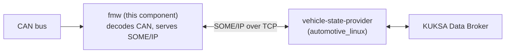
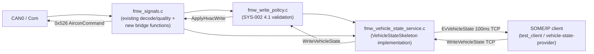

# vehicle_state_service (Gateway ECU / autoas-as / fmw)

## Overview

`vehicle_state_service` is the SOME/IP `VehicleStateService` server that
runs on the `autoas-as` AUTOSAR-CP Gateway ECU, in
`autoas-as/src/app/fmw`. It bridges the vehicle's CAN bus to the Linux
vehicle-state stack (KUKSA Data Broker):



- It decodes the CAN messages already handled by the existing `fmw`
  application (`fmw_signals.c`, per SYS-001) and republishes 15 vehicle
  signals through a SOME/IP `VehicleStateService` (SYS-002 / SWARCH-002).
- It accepts a `WriteVehicleState` request (for example, from the KUKSA Data
  Broker's actuator path) and applies HVAC changes back onto the CAN bus.
- It can replace the Linux-side mock server (`someip-server` in
  `automotive_linux/.../src/examples/vehicle_state_service`) with a real,
  CAN-backed implementation.

Status: implemented and verified end-to-end, both standalone (see
[Standalone (No Docker)](#standalone-no-docker)) and through the full
`docker compose` stack (see [With docker compose](#with-docker-compose)),
covering both CAN -> SOME/IP -> KUKSA Data Broker reads and Data Broker
actuator -> SOME/IP -> CAN writes.

## Related Documents

### Specifications

| Type | File | Content Used |
|---|---|---|
| SYS | SYS-001-can-signal.md | CAN frame definitions and timeout/quality/confidence rules |
| SYS | SYS-002-someip.md | Service/Event/Method IDs, KEY/VALUE definitions, and the LKV binary specification |
| SYS | SYS-004-cdcf-diff.md | Rationale for quality/confidence/timeout rules |
| SYS | SYS-005-vss-catalog-reference.md | VSS path validation (Linux-side concern) |
| SWARCH | SWARCH-000-overview.md | Overall deployment configuration |
| SWARCH | SWARCH-002-someip-server.md | Server module decomposition, event loop, and Write behavior |
| SWARCH | SWARCH-001-linux-vehicle-service.md | Linux-side receiver conversion specification |
| SWRS | SWRS-Gateway-ECU.md | Gateway ECU SHALL requirements |
| SWRS | SWRS-CDC-AllSignals.md | Detailed SHALL requirements and threshold tables for 11 signals |

### Related READMEs

| Document | Content |
|---|---|
| [`autoas-as/README.md`](../../../README.md) | Docker Compose build/run procedure (`docker compose up` -> `batch_build.sh` -> run `FmwApp` -> start `webcan`) |
| [`autoas-as/docs/fmwapp.md`](../../../docs/fmwapp.md) | Primary implementation specification for `FmwApp` (this `fmw`): CAN signal spec -> Com/CanIf/PduR JSON -> generator workflow, `lssg`/`wrsg` shell commands, and use of `webcan` |
| [`autoas-as/docs/build.md`](../../../docs/build.md) | Detailed Docker Compose build procedure |
| [`autoas-as/src/README.md`](../../README.md) | Overview of the entire AS - Automotive Software project |
| [`src/infras/communication/SomeIp/README.md`](../../infras/communication/SomeIp/README.md) | Native `SomeIp` stack send/receive sequence diagrams |
| [`src/app/examples/someip/ara/RadarService`](../examples/someip/ara/RadarService/) | `Network.json` + generator + Skeleton/Proxy example this implementation follows |
| [`src/app/examples/someip/add/README.md`](../examples/someip/add/README.md) | Minimal SOME/IP request/response example |
| [`src/app/examples/someip/can/README.md`](../examples/someip/can/README.md) | Example `Network.json` editing workflow using `json.editor` |

## Design Notes

The existing `fmw` application (`src/fmw_signals.c`) already decodes all 12
CAN messages defined in SYS-001 (Speed, TacoMeter, Aircon,
AirconCommand(TX), Reverse, ParkingBrake, ESC, ABS, Seatbelt, DoorOpen,
Airbag, LowFuel) via Com, including per-signal `quality`/`confidence`
tracking. Those decoded values were `static` file-scope variables with no
external accessor, so this work added a small bridge
(`fmw_vehicle_state_bridge.h`, implemented at the end of `fmw_signals.c`) to
expose them to SOME/IP.

`autoas-as` supports two ways to implement a SOME/IP service: the native
`SomeIp`/`SomeIpXf`/`Sd`/`SoAd` stack, with JSON-declared services and
generator-produced ara::com-style Skeleton/Proxy code (as in
`examples/someip/ara/RadarService`), or linking vsomeip3 directly. This
implementation uses **the native stack**, so it reuses the existing
generator, infrastructure, and build pattern without an extra vsomeip3
dependency.

The native stack's generator requires struct fields to follow a fixed
schema (a capped variable-length array is supported, but each array element
must itself be a fixed size). SYS-002's original LKV payload was a
variable-length, self-describing TLV, so this implementation instead uses a
fixed-length LKV schema capped at a maximum entry count:

```text
LkvEntry (fixed 20 bytes)
  uint16  key_id
  uint8   quality        // 0=OK, 1=INVALID, 2=STALE
  uint8   confidence      // 0..3
  uint64  timestamp_ms
  uint32  age_ms
  float32 value            // bool/uint8/float32 values are all represented
                            // as float32 (0/1 and 0..255 both convert
                            // without loss of precision)

VehicleStateMessage
  uint16  schema_version
  LkvEntry entries[kMaxEntries]   // variable_array + size=kMaxEntries(=16);
                                  // the generator adds a length prefix for
                                  // the actual entry count, so entry_count/
                                  // value_type/value_length/source are
                                  // dropped
```

- `value_type` is dropped; the type is uniquely determined by `key_id` (the
  KEY table in SYS-002 Section 4.1 is the authoritative type reference).
- `source` is dropped in favor of a single fixed string, `"Gateway ECU"`,
  for the whole service.
- `WriteVehicleState` uses the same `LkvEntry` type, limited to the 5
  writable keys (`0x1006`-`0x100A`).

This schema is wire-incompatible with the original variable-length TLV used
by the Linux-side mock server. The Linux-side `vehicle_state_adapter.cc` was
updated to use the same fixed-length schema (see
[With docker compose](#with-docker-compose)).

## Architecture



All modules are plain C (no C++), all under `autoas-as/src/app/fmw`:

| File | Role |
|---|---|
| `config/SomeIp/Network.json` | Declares the `VehicleStateService` (Service `0x1770`/Instance `0x0001`, TCP `reliable:30512`) structs (`LkvEntry`/`VehicleStateMessage`/`WriteRequest`/`WriteResponse`), event (`EvVehicleState` 0x8001), and methods (`GetVehicleStateSnapshot` 0x0001, `WriteVehicleState` 0x0002) |
| `config/SomeIp/Mempool.json` | Memory pool configuration for the native `SoAd`/`SomeIp` stack |
| `include/fmw_vehicle_state_bridge.h` + tail of `fmw_signals.c` | SYS-002 Key constants, quality/confidence conversion, `FmwVehicleState_GetSnapshot()` (assembles 15 entries), `FmwVehicleState_ApplyHvacWrite()` (updates `AirconCommand.cmd*` and sends CAN), and `FmwVehicleState_NowMs()` |
| `include/fmw_write_policy.h` / `src/fmw_write_policy.c` | `FmwWritePolicy_Apply()`: SYS-002 Section 4.1 range validation (all-or-nothing); on success, applies the change via the bridge and echoes back `applied_state` |
| `include/fmw_vehicle_state_service.h` / `src/fmw_vehicle_state_service.c` | The plain-C skeleton implementation (`SomeIp_SkeletonC`), `FmwVehicleStateService_Init()` (calls `VehicleState_OfferService()`), and `FmwVehicleStateService_MainFunction10ms()` (calls `VehicleState_SendEvVehicleState()` every 100 ms) |
| `test_client/` (not part of the production image) | See [Standalone (No Docker)](#standalone-no-docker) |

### Process/Thread Model

- The existing `Task_MainLoop` (1 ms polling) requires no changes.
- `TcpIp`/`SoAd`/`Sd`/`SomeIp` Init/MainFunction calls are handled
  automatically by `EcuM` whenever `USE_TCPIP`/`USE_SOAD`/`USE_SD`/
  `USE_SOMEIP` are defined (which `SConscript` supplies automatically), so no
  explicit wiring is needed on the fmw side.
- Only two calls are added: `FmwVehicleStateService_Init()` (once, from
  `Fmw_Init()`) and `FmwVehicleStateService_MainFunction10ms()` (every cycle,
  from `Fmw_MainFunction10ms()`, which internally sends
  `VehicleState_SendEvVehicleState()` once every 10 calls, i.e. every 100 ms).

## CAN -> SOME/IP Key Mapping

| SYS-002 Key | Name | Value in fmw_signals.c | quality/confidence Source | Notes |
|---:|---|---|---|---|
| 0x1001 | Speed | `Speed_Kph` | `Speed_Q` | float |
| 0x1002 | TacoMeter | `EngineSpeed_Rpm` | `TacoMeter_Q` | float |
| 0x1004 | Reverse | `Reverse_Engaged` | `Reverse_Q` | bool (gear conversion happens on the Linux side; the Gateway layer sends the raw bool) |
| 0x1005 | ParkingBrake | `ParkingBrake_Applied` | `ParkingBrake_Q` | bool |
| 0x1006 | Aircon ON/OFF | `Aircon.acOnOff` | `Aircon_Q` | bool, writable |
| 0x1007 | Aircon Temperature | `Aircon.targetTempC` | same as above | float, writable |
| 0x1008 | Aircon Fan | `Aircon.fanLevel` | same as above | uint8 0..7, writable |
| 0x1009 | Aircon Defrost | `Aircon.defrost` | same as above | bool, writable |
| 0x100A | Aircon Mode | `Aircon.mode` | same as above | uint8 0..6, writable |
| 0x100C | ESC IsError | `ESC_Error` | `ESC_Q` | bool |
| 0x100D | ABS IsError | `ABS_Error` | `ABS_Q` | bool |
| 0x100E | Seat IsBelted | `Seatbelt.row1Driver` (fixed to Row1.DriverSide, SWARCH-002 Section 7) | `Seatbelt_Q` | bool |
| 0x100F | Door IsOpen | `DoorOpen.row1Driver` | `DoorOpen_Q` | bool |
| 0x1010 | Airbag IsDeployed | `Airbag.row1Driver` | `Airbag_Q` | bool |
| 0x1011 | Fuel RelativeLevel | `LowFuel_Percent` | `LowFuel_Q` | uint8 0..100 |

Conversion rules:
- `confidence`: `0/40/60/100` -> SYS-002 `0/1/2/3` (roughly
  `level = confidence/40`, but 100->3 needs special-case handling; handled
  with a simple `switch`).
- `quality`: `FMW_Q_OK`->`0x00`, `FMW_Q_STALE`->`0x02`, `FMW_Q_INVALID`->`0x01`;
  `FMW_Q_UNKNOWN` (right after startup, before any reception) maps to
  `0x01` (`INVALID`). This pairs with `confidence=0`; the Linux side keeps
  the last valid value while `INVALID`, so the practical impact is small.
- `age_ms` = `ctx->elapsedMs` (the existing field can be used as-is).
- `timestamp_ms` = the Gateway ECU's send time (epoch ms; a new helper is
  needed).
- `source` = the fixed string `"Gateway ECU"` (aligned with the Linux side's
  `kDefaultSource`).

## Service Interface

- **GetVehicleStateSnapshot (0x0001)**: assembles and returns a current-value
  snapshot of the 15 keys in the table above on each call (sharing the same
  assembly logic used for event transmission).
- **WriteVehicleState (0x0002)**:
  1. Validate the request (`LkvEntry[]`, at most 5 entries).
  2. Perform all-or-nothing validation in `fmw_write_policy` (key range
     0x1006-0x100A; types and ranges per SYS-002 Section 4.1).
  3. If validation succeeds, update `AirconCommand.cmd*` in `fmw_signals.c`
     via `fmw_vehicle_state_bridge`, letting the existing
     `Fmw_ApplyAirconCommand()` send it as CAN frame 0x526 on the next 10 ms
     tick. The Gateway ECU does not itself verify or retain a "reflected"
     state for CAN (see Known Limitations).
  4. Return a `WriteResponse` (`result_code`/`failed_entry_index`, and
     `applied_state` only on success). `applied_state` simply echoes back the
     values accepted in the write request (it is returned as an
     acknowledgment of acceptance, not as confirmation of actual reflection
     over CAN).
  5. Whether the change is actually reflected as intended on the CAN bus can
     be checked using `autoas-as/src/tools/webcan`; this is not something the
     Gateway ECU verifies itself.

## Known Limitations

- The Gateway ECU does not implement the receiving side (`FMW_HVAC`) of CAN
  frame 0x526 (`AirconCommand`), so it cannot confirm on its own that a
  `WriteVehicleState` was actually applied on the bus. Use
  `autoas-as/src/tools/webcan` to verify the CAN frame's actual value.
- After restarting the `gateway-ecu` container, `vehicle-state-provider`'s
  SOME/IP subscription sometimes does not resume automatically. Workaround:
  `docker compose restart vehicle-state-provider`.
- `Vehicle.Cabin.HVAC.Station.Row1.Driver.AirDistribution` stays
  `NotAvailable` unless Aircon Mode is `4`/`5`/`6` (UP/DOWN/MIDDLE); this is
  by design (no other Aircon Mode value has a corresponding VSS value), not a
  defect.
- `FmwApp` has occasionally been observed to terminate after running for a
  long time (root cause not yet identified). If SOME/IP events stop
  arriving, first confirm the process is still alive
  (`docker exec gateway-ecu ps -eo pid,stat,comm`) before assuming it is a
  subscription problem.

## Traceability

- CAN signal definitions: SYS-001
- SOME/IP contract: SYS-002 Section 5.2 (fixed-length schema), SWARCH-002
- Gateway ECU requirements: SWRS-Gateway-ECU, SWRS-CDC-AllSignals
- Reference implementation (existing mock used as a design reference; wire
  incompatible):
  `automotive_linux/vehicle_service/workspace/kuksa-someip-provider/src/examples/vehicle_state_service`
- Reference implementation (build configuration template):
  `autoas-as/src/app/examples/someip/add` (plain-C skeleton/proxy),
  `autoas-as/src/app/app/config/Net` (the `AntiTest` server+client
  self-testing pattern)

## Building and Running

### Standalone (No Docker)

A minimal way to build and exercise the server without any of the Linux
vehicle-state stack: a dedicated SOME/IP test client
(`test_client/`, not included in the production Gateway ECU image) talks to
`FmwApp` directly. It uses the same build configuration as `add`/
`RadarService`, with its own `config/Network.json` that declares
`VehicleState` on the **client** side (the struct/service/instance/port must
match `config/SomeIp/Network.json` on the production server side; if either
one is changed in the future, fix both). `test_client` also exercises
`WriteVehicleState` with both valid and invalid inputs, so it can be used as
a quick regression check.

```sh
cd autoas-as/src
scons --app=FmwApp
scons --app=FmwVehicleStateTestClient
# Start the server (separate process)
AS_LOCAL_IP=127.0.0.1 ./build/posix/GCC/FmwApp/FmwApp -v 1
# Start the client (separate process)
AS_LOCAL_IP=127.0.0.1 ./build/posix/GCC/FmwVehicleStateTestClient/FmwVehicleStateTestClient
```

**`AS_LOCAL_IP` is required**: if unset, `TcpIp_GetLocalIpAddr()` embeds
`0.0.0.0` as its own IP in the SOME/IP-SD OFFER/SUBSCRIBE, and the peer's
`Sd.c` address check determines it does not match, so the service is never
found. When running two processes on the same host, set
`AS_LOCAL_IP=127.0.0.1` on both.

Once running, you should see Service Discovery succeed, the client subscribe
to `EventGroupVehicleState`, `EvVehicleState` arrive every 100 ms with 15
entries, `GetVehicleStateSnapshot` return the same 15 entries on demand, and
`WriteVehicleState` (e.g. Aircon ON/OFF + Temperature) return
`resultCode=0`.

### With docker compose

The full vehicle-state stack (CAN simulator/`webcan` -> `gateway-ecu`
(`FmwApp`) -> `vehicle-state-provider` -> `databroker`) can be run together
via `docker compose`, using the repository-root `docker-compose.yml` (moved
there from `automotive_linux/vehicle_service/docker-compose.yml` so it can
also cover `metapp`; see `metapp/README.md` §8.2).
A `gateway-ecu` service builds `autoas-as` (build context `./autoas-as`,
reusing `autoas-as/docker/Dockerfile`) via
`autoas-as/docker/run-fmw-gateway.sh`, which builds with
`scons --app=FmwApp`, starts it in the background, and starts `webcan` in the
foreground. The old `vehicle-state-server` mock is kept under
`profiles: ["mock"]` for reference and is not started by default.

`gateway-ecu` reuses the same static IP (`172.30.0.12`) and port (`30512`)
that the mock used, so `vehicle-state-provider`'s `vsomeip.json`
(`unicast: 172.30.0.12`, `reliable: 30512`) works without modification.
`AS_LOCAL_IP=172.30.0.12` is set on `gateway-ecu` for the same reason
described above.

```sh
# from the repository root
docker compose up -d databroker gateway-ecu vehicle-state-provider
curl -X POST http://localhost:8800/api/buses \
  -H "Content-Type: application/json" \
  -d '{"device":"simulator_v2","port":0,"baudrate":500000}'   # connect webcan to CAN0
```

See [Verifying the Setup](#verifying-the-setup) for how to check that
everything is working end-to-end.

## Verifying the Setup

Once the stack is running (standalone or via `docker compose`), the
end-to-end behavior looks like this:

| Path | Result |
|---|---|
| Startup of `FmwApp` / `webcan` | OK |
| SD OFFER (`0x1770`/`0x0001`, major 1, TTL 5, TCP 30512) | OK |
| `EventGroupVehicleState` subscribed -> `EvVehicleState` received at 10Hz | OK |
| CAN reception -> 15 signals with `quality=OK` / `confidence=3` | OK |
| VSS reflection to Databroker (8 paths, plus `IsDefrosting` with the overlay below) | OK |
| Databroker actuator -> `WriteVehicleState` -> CAN `0x526` | OK |

Measured Databroker values (CAN values periodically injected from `webcan`
appear as-is):

```
Vehicle.Speed:                                        60.00 km/h
Vehicle.Powertrain.CombustionEngine.Speed:          1500.00 rpm
Vehicle.Powertrain.FuelSystem.RelativeLevel:            80 percent
Vehicle.Chassis.ParkingBrake.IsEngaged:               true
Vehicle.Cabin.HVAC.IsAirConditioningActive:           true
Vehicle.Cabin.HVAC.Station.Row1.Driver.Temperature:  28.00 Celsius
Vehicle.Cabin.HVAC.Station.Row1.Driver.FanSpeed:       100 percent
Vehicle.Cabin.HVAC.Station.Row1.Driver.AirDistribution: 'UP'
Vehicle.Cabin.HVAC.Station.Row1.Driver.IsDefrosting:  true      (see Databroker VSS Overlay below)
```

For the write direction, a value set via `databroker-cli actuate` appears in
CAN frame `0x526 AirconCommand` (`FanSpeed 29%` -> `CmdFanLevel=0x02` =
`round(29*7/100)`, `Temperature 19.0` -> `CmdTargetTempRaw=0x06` =
`(19.0-16)/0.5`).

### Step-by-Step Verification

The procedure for reproducing and confirming the end-to-end behavior above.

**1. Check container status**

```sh
# from the repository root
docker compose ps
# Confirm databroker / gateway-ecu / vehicle-state-provider are Up
```

**2. Connect the CAN bus and periodically inject signals**

`webcan` runs inside the `gateway-ecu` container. The bus is cleared on
every container restart, so it must be reconnected each time:

```sh
curl -X POST http://localhost:8800/api/buses \
  -H "Content-Type: application/json" \
  -d '{"device":"simulator_v2","port":0,"baudrate":500000}'

# From here, post to /api/buses/0/periodic/signals using "physical values"
# (not raw values). TargetTempRaw has offset 16 / scale 0.5, so writing
# 24 yields 24 degC. Writing the raw value 8 is out of range and becomes
# INVALID.
curl -X POST http://localhost:8800/api/buses/0/periodic/signals \
  -H "Content-Type: application/json" \
  -d '{"message":"Speed","signals":{"VehicleSpeedRaw":60},"period_ms":100}'
curl -X POST http://localhost:8800/api/buses/0/periodic/signals \
  -H "Content-Type: application/json" \
  -d '{"message":"Aircon","signals":{"AC_OnOff":1,"Defrost":1,"Mode":4,"FanLevel":7,"TargetTempRaw":28},"period_ms":100}'
# Injecting the rest (TacoMeter / ParkingBrake / Reverse / ESC / ABS /
# Seatbelt / DoorOpen / Airbag / LowFuel) the same way brings all 15
# signals to quality=OK (signals not injected stay STALE).
```

**3. Confirm the subscription succeeded via the `vehicle-state-provider` logs**

```sh
docker compose logs vehicle-state-provider --tail 200 | grep -v "vSomeIP 3.1.20.3"
```

What appears in the normal case (if these 4 lines are all present, the
subscription has succeeded):

```
# SomeIPClient<...>::on_availability: [info] Service [1770.0001] is available.
# SomeIPClient<...>::on_availability: [info] Event service now available; requesting event and subscribing
# SomeIPClient<...>::init_event_service: [info] Subscribing [1770.0001] ver.1, event_group:0x0001, event:0x8001
[info] SUBSCRIBE(1416): [1770.0001.0001:8001:1]
```

Injecting CAN produces 15 more lines:

```
# VehicleStateAdapter::handle_event: [info] key 0x1001 -> OK (recovered after 2 consecutive valid samples)
...
```

If `create_eventgroup_entry: Cannot create subscription as local reliable
port is zero` appears right after a `gateway-ecu` restart and the
subscription does not recover, see Known Limitations.

**4. Decode the actual `EvVehicleState` payload**

If the subscription has succeeded, 322-byte events flow at 10Hz over the TCP
connection from `gateway-ecu:30512` to `provider`. The contents can be
verified with a raw `AF_PACKET` capture (the `provider` container has
Python3):

```
event: ifVer=1 msgType=0x02 structLen=304 schemaVersion=1 entries=15
  0x1001 Speed              q=OK      conf=3 age=    40ms value=60.0
  0x1007 AirconTemperature  q=OK      conf=3 age=    30ms value=28.0
  ...
```

The payload layout is
`structLen(uint16) schemaVersion(uint16) arrayLen(uint16) entry[15]`,
where `LkvEntry` is 20 bytes (`keyId(2) quality(1) confidence(1)
timestampMs(8) ageMs(4) value(4)`). Since `arrayLen` is a byte count,
`entries = arrayLen / 20`.

**5. Check the VSS values on the Databroker side**

`databroker-cli` requires a TTY, so give it a pty via `script`:

```sh
docker exec -e TERM=xterm databroker sh -c 'script -qec \
  "./target/release/databroker-cli get Vehicle.Speed \
   Vehicle.Cabin.HVAC.Station.Row1.Driver.Temperature" /dev/null'
```

If `NotAvailable` is returned, it is one of: (1) CAN not injected, so
`quality=STALE`; (2) out of `ValueInRange`, so `INVALID`; or (3) a value that
simply does not map to a VSS value at all, like `AirDistribution` (see
Known Limitations). Whether the event itself is not arriving or the value is
being discarded can be distinguished by looking at `q=` in the raw payload
from step 4.

**6. Check the write direction (Databroker actuator -> CAN)**

```sh
docker exec -e TERM=xterm databroker sh -c 'script -qec \
  "./target/release/databroker-cli actuate \
   Vehicle.Cabin.HVAC.Station.Row1.Driver.FanSpeed 29" /dev/null'
```

If `SendRequest: ... Sending Request to [1770.0001.0002]` and
`handle_write_response: [info] WriteResponse result_code=0
failed_entry_index=255` appear in the `provider` logs, the SOME/IP method
call succeeded.

Reflection on the CAN side can be seen in the `webcan` trace:

```sh
curl -s "http://localhost:8800/api/trace?limit=400" \
  | python3 -c "import json,sys; [print(x['dir'], x['canid'], x['data']) \
      for x in json.load(sys.stdin) if x['canid'].upper()=='526']" | tail -3
# rx 526 0702060500000000
#   byte1=0x02 CmdFanLevel=2  (= round(29*7/100))
#   byte2=0x06 CmdTargetTempRaw -> 6*0.5+16 = 19.0 degC
```

**7. To invoke a method call independently of subscription**

Pointing a raw TCP SOME/IP client equivalent to `test_client` (see
[Standalone (No Docker)](#standalone-no-docker)) at `gateway-ecu`'s
IP:30512 allows checking `GetVehicleStateSnapshot`/`WriteVehicleState`
individually, regardless of subscription state. However, `SoAd` has a limit
on the number of TCP connections, and opening a second connection while
`vehicle-state-provider` is holding one results in a `ConnectionResetError`.
Either stop the provider first, or use `test_client` in its local
configuration.

## Databroker VSS Overlay (`IsDefrosting`)

`0x1009 Aircon Defrost` has no corresponding path in VSS 6.0 (SYS-005
Section 5). Feeding this path to a databroker started with only the standard
catalog produces repeated errors like:

```
# DataBrokerFeeder::feedToBroker: [error]     Set error for
'Vehicle.Cabin.HVAC.Station.Row1.Driver.IsDefrosting':
Vehicle.Cabin.HVAC.Station.Row1.Driver.IsDefrosting not found
```

**Fix**: start databroker with a custom overlay.

- `automotive_linux/vehicle_service/databroker/vss_fmw_overlay.json` (new)
- The `CMD` in `databroker/Dockerfile` uses
  `--vss data/vss-core/vss_release_6.0.json,/app/vss_fmw_overlay.json`
  (`--vss` takes a comma-separated list)

The registered path is
`Vehicle.Cabin.HVAC.Station.Row1.Driver.IsDefrosting` (`boolean`,
`actuator`). It is an `actuator` because SYS-002 Section 4.1 includes
`0x1009` among the writable keys (`0x1006..0x100A`).

Implementation notes:

- kuksa-databroker processes each `--vss` file **independently** and calls
  `add_entry()` **per leaf** (`databroker/src/main.rs::read_metadata_file()`).
  Therefore, redeclaring the `Vehicle` -> `Cabin` -> `HVAC` -> `Station` ->
  `Row1` -> `Driver` branch chain on the overlay side does not conflict with
  the standard catalog; only the new leaf is added.
- The parser (`databroker/src/vss.rs`) requires `description` **even for
  branches** (it is not `Option`).
- Place `COPY` **after** `cargo build --release` in the Dockerfile, or every
  edit to the overlay triggers a full rebuild.

The write direction is enabled at the same time: `kuksa.val.v1`'s
`Subscribe` fails the **entire request** if even one path is unknown, so
without this overlay, actuation for all 5 HVAC keys
(`0x1006..0x100A`) becomes invalid, not just `IsDefrosting`.
