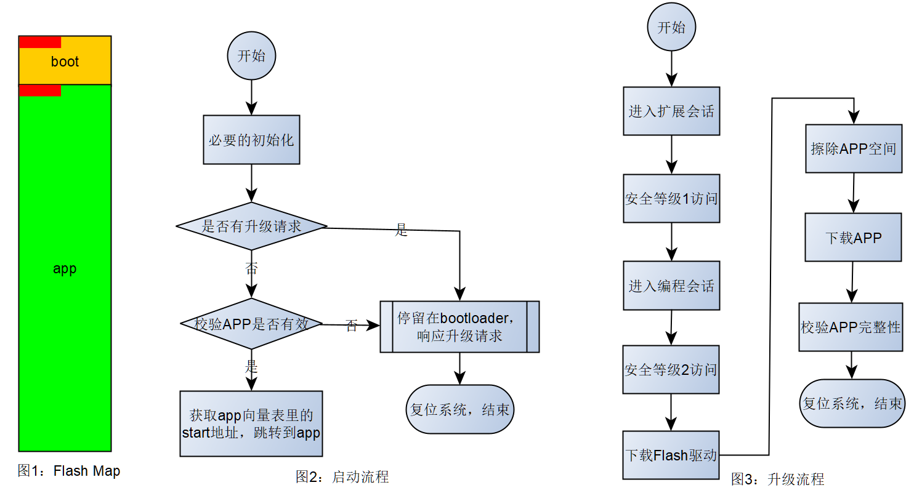

# Introduction to CAN Bootloader

The automotive industry is going through major changes. First, vehicles are moving from fuel-based platforms to electric ones. Second, if a car has no advanced driver assistance features, it almost feels outdated. Influenced by Tesla-style Internet thinking, many manufacturers are now following the same pattern: ship capable hardware first, then keep iterating software features later. As a result, when a vehicle is built, one of the first requirements is often that every ECU should support OTA updates.

This article is not about OTA itself. Regardless of the update channel, traditional MCU-based automotive controllers still mostly communicate over CAN, so this article focuses on how a bootloader for such MCUs is usually designed and how it works.

For an MCU bootloader, there are two major responsibilities:

* Booting and starting the application.
* Responding to upgrade requests and programming a new application.

## The Boot Process

In automotive MCUs, programs are normally stored in Flash. After power-up, the MCU starts executing instructions from a fixed address in Flash. That area is typically reserved as the boot region and stores the bootloader. Everything outside that region is used as the application region and stores the main application.

Figure 1 shows a simple example. The red areas represent the interrupt vector tables of the bootloader and the application respectively.



Normally, the first entry in the interrupt vector table is the reset vector, which points to the program entry function. That function is usually written in assembly and prepares the C runtime environment, such as initializing the data section, the BSS section, and the stack. After that, `main()` starts executing. This article does not go deeper into MCU C runtime setup, but it is worth studying separately.

As shown in Figure 2, this is the normal path in which the bootloader starts the application. The normal startup flow is intentionally simple so that the application can be launched as quickly as possible and system boot response stays fast.

## The Loader Programming Process

In general, the loader part of the MCU bootloader behaves as a UDS service provider. It acts as a server and responds to UDS requests from a client in order to complete an application update, roughly as shown in Figure 3.

This article does not yet go into detail about which UDS services are involved in each step. Before that, it is more important to understand the three projects that a typical bootloader solution needs:

* The bootloader project.
* The Flash Driver project.
* The application project.

## QEMU Versatilepb Bootloader Demo

The rest of this article uses the QEMU Versatilepb virtual machine as an example to explain what those three projects look like and what a complete programming flow looks like.

The demo code is open source here: [autoas/qemu](https://github.com/autoas/qemu)

Let us build and run the example first.

First, refer to [Development Environment Setup](build-env-setup.md) to prepare the build environment and toolchain, then launch the ConEmu terminal through `Console.bat` in the `ssas-public` project directory.

```sh
# In the app tab, run the following commands
D:\repository\ssas-public>cd app\platform
D:\repository\ssas-public\app\platform>git clone https://github.com/autoas/qemu.git
D:\repository\ssas-public\app\platform>cd ../..

# Start building
D:\repository\ssas-public>scons --app=Loader
D:\repository\ssas-public>scons --app=CanBridge
D:\repository\ssas-public>scons --app=CanDump

# Enable CAN FD mode with a maximum payload size of 64 bytes
D:\repository\ssas-public>set LL_DL=64
D:\repository\ssas-public>scons --cpl=QemuVersatilepbGCC --app=VersatilepbFlashDriver
# The first build can take a while because gcc-arm-none-eabi must be downloaded
D:\repository\ssas-public>scons --cpl=QemuVersatilepbGCC --app=VersatilepbCanApp
D:\repository\ssas-public>scons --cpl=QemuVersatilepbGCC --app=VersatilepbCanBL

# Now modify app/app/main.c and change the log in main() to:
# int main(int argc, char *argv[]) {
#   ASLOG(INFO, ("application v2 build @ %s %s\n", __DATE__, __TIME__));
# Then rebuild CanApp
D:\repository\ssas-public>scons --cpl=QemuVersatilepbGCC --app=VersatilepbCanApp

# Switch back to the app tab and start the QEMU virtual machine
D:\repository\ssas-public>scons --cpl=QemuVersatilepbGCC --app=VersatilepbCanBLRun
scons: Reading SConscript files ...
qemu-system-arm.exe: -serial tcp:127.0.0.1:9000,server: info: QEMU waiting for connection on: disconnected:tcp:127.0.0.1:9000,server=on

# In the sim tab, start CanBridge
D:\repository\ssas-public>build\nt\GCC\CanBridge\CanBridge.exe -d qemu -d simulator_v2

# In the tool tab, start CanDump
D:\repository\ssas-public>build\nt\GCC\CanDump\CanDump.exe

# Switch back to the app tab
INFO    :bootloader build @ Dec 15 2021 19:26:46
INFO    :application is valid
INFO    :application build @ Dec 14 2021 22:55:11
# This shows that the bootloader successfully started the application,
# and since there is no "v2" in the log, the old application is still running.

# Once the virtual machine is fully up, switch to the boot tab and start programming.
# Add "-v" for more detailed logs.
D:\repository\ssas-public>build\nt\GCC\Loader\Loader.exe -a build\nt\QemuVersatilepbGCC\VersatilepbCanApp\VersatilepbCanApp.s19.sign -f build\nt\QemuVersatilepbGCC\VersatilepbFlashDriver\VersatilepbFlashDriver.s19.sign -l 64

# Because this is a simulation, the programming process may be slow.
# On my laptop, one CAN frame can take around 100 ms to complete (bug still under investigation).
# You can switch between the app and boot tabs to observe the logs.
# If you see errors, they are usually caused by CANTP timeout on Windows,
# which is not a real-time operating system. Just rerun the command above to restart the update process.
# If it still fails after several tries, skip it and move on to the Host-based CanBL demo.

# Eventually, in the boot tab, you should see something like this:
block information of build\nt\QemuVersatilepbGCC\VersatilepbCanApp\VersatilepbCanApp.s19.sign:
srec 0: address=0x00040000, length=0x0000C5C0, offset=0x00000000, data=18F09FE518F09FE5 crc16=C022
srec 1: address=0x0013FFFE, length=0x00000002, offset=0x0000C5C0, data=05C3 crc16=BD5
block information of build\nt\QemuVersatilepbGCC\VersatilepbFlashDriver\VersatilepbFlashDriver.s19.sign:
srec 0: address=0x00140000, length=0x00000568, offset=0x00000000, data=010200A918001400 crc16=4E9D
srec 1: address=0x00140FFE, length=0x00000002, offset=0x00000568, data=4DBF crc16=30AB
loader started:
enter extended session          progress  0.10%  okay
level 1 security access         progress  0.30%  okay
enter program session           progress  0.40%  okay
level 2 security access         progress  0.60%  okay
download flash driver           progress  3.62%  okay
erase flash okay
download application            progress 95.91%  okay
check integrity                 progress 96.01%  okay
ecu reset                       progress 99.00%  okay
loader exited without error
                                progress 100.00%

# In the app tab, you should then see:
INFO    :bootloader build @ Dec 15 2021 19:26:46
INFO    :application is valid
INFO    :application build @ Dec 14 2021 22:55:11
DCM     :physical service 10, len=2
INFO    :App_GetSessionChangePermission(1 --> 3)
DCM     :physical service 27, len=2
INFO    :App_GetExtendedSessionSeed(seed = CF712C84)
DCM     :physical service 27, len=6
INFO    :App_CompareExtendedSessionKey(key = B7E26AF7(B7E26AF7))
DCM     :physical service 10, len=2
INFO    :App_GetSessionChangePermission(3 --> 2)
INFO    :bootloader build @ Dec 15 2021 19:26:46
DCM     :physical service 27, len=2
DCM     :physical service 27, len=6
DCM     :physical service 34, len=11
DCM     :download memoryAddress=0x50000 memorySize=0x568
...
...
DCM     :physical service 31, len=4
DCM     :start p2server
DCM     :physical service 11, len=2
INFO    :bootloader build @ Dec 15 2021 19:26:46
INFO    :application is valid
INFO    :application v2 build @ Dec 15 2021 21:47:05
# Once you see the "v2" string, the update succeeded and the new application is running.
```

There are many steps above and the process takes time, so be patient. If you add the `-v` option, you will see much more detail. From that output, it becomes clear that application programming is implemented as a combination of UDS services.

```sh
build\nt\GCC\Loader\Loader.exe -v -a build\nt\QemuVersatilepbGCC\VersatilepbCanApp\VersatilepbCanApp.s19.sign -f build\nt\QemuVersatilepbGCC\VersatilepbFlashDriver\VersatilepbFlashDriver.s19.sign -l 64

loader started:
enter extended session
 request service 10:
  TX: len=2 10 03
  RX: len=6 50 03 13 88 00 32
  PASS
 okay
level 1 security access
 request service 27:
  TX: len=2 27 01
  RX: len=6 67 01 CF 71 2C 84
  PASS
...
...
download flash driver
 request service 34:
  TX: len=11 34 00 44 00 05 00 00 00 00 05 68
  RX: len=4 74 20 02 02
  PASS

 request service 36:
  TX: len=514 36 01 01 02 00 A9 18 00 05 00 84 00 05 00 B0 00 05 00 2C 02 05 00 B8 03 05 00 04 B0 2D E5 00 B0
  RX: len=2 76 01
  PASS

 request service 36:
  TX: len=514 36 02 00 20 A0 E3 B4 20 C3 E1 03 00 00 EA 02 00 00 EA 18 30 1B E5 01 20 A0 E3 B4 20 C3 E1 00 00
  RX: len=2 76 02
  PASS

 request service 36:
  TX: len=362 36 03 0C 30 0B E5 20 30 1B E5 08 30 93 E5 10 30 0B E5 20 30 1B E5 10 30 93 E5 14 30 0B E5 10 30
  RX: len=2 76 03
  PASS

 request service 37:
  TX: len=1 37
  RX: len=1 77
  PASS
 ...
 ...
```

### About the Three Bootloader Projects

This example uses QEMU Versatilepb. The address range `0x00008000` to `0x00140000` is treated as Flash with a size of 1248 KB, while `0x00140000` to `0x00180000` is treated as RAM with a size of 256 KB. In reality, this QEMU machine only has RAM. A portion of that RAM is simply abstracted as Flash for the purpose of simulation.

Now go back to the three projects needed by a bootloader solution.

The first one is the bootloader itself, which obviously resides at the start of the Flash region, as shown earlier in Figure 1. That leads to a practical question: how do you compile and link the bootloader so it lands exactly in the boot region? The answer is the linker script.

Take the QEMU Versatilepb bootloader linker script [linker-boot.lds](https://github.com/autoas/qemu/versatilepb/linker-boot.lds) as an example. Different toolchains use different linker-script syntaxes, but the idea is the same.

```txt
MEMORY
{
   FLASH        (rx)   : ORIGIN = 0x00008000, LENGTH = 224K
   APPCODE      (rx)   : ORIGIN = 0x00040000, LENGTH = 1024K
   FLSDRV       (rwx)  : ORIGIN = 0x00140000, LENGTH = 4K
   RAM          (rwx)  : ORIGIN = 0x00141000, LENGTH = 252K
}
```

This fragment shows that the range from `0x00008000` to `0x00040000` is reserved as the boot region, while everything from `0x00040000` onward is used as the application region. The corresponding application linker script [linker-app.lds](https://github.com/autoas/qemu/versatilepb/linker-app.lds) contains this part:

```txt
MEMORY
{
   FLASH        (rx)   : ORIGIN = 0x00040000, LENGTH = 1024K
   RAM          (rwx)  : ORIGIN = 0x00140000, LENGTH = 256K
}
```

Now look at the Flash Driver linker script [linker-flsdrv.lds](https://github.com/autoas/qemu/versatilepb/linker-flsdrv.lds):

```txt
MEMORY
{
  FLASH        (rwx)  : ORIGIN = 0x00140000, LENGTH = 4K
}

ENTRY(FlashHeader)

SECTIONS
{
    .text :
    {
      *(.rodata*)
      *(.text*)
    } > FLASH
}
```

If you compare them carefully, you will notice that the bootloader RAM is 4 KB smaller than the application's RAM. Where did those 4 KB go? They are reserved for the Flash Driver. If you add the Flash Driver memory region back to the bootloader RAM, the total becomes 256 KB again. That means the bootloader must reserve some RAM to receive and execute the downloaded Flash Driver. In other words, the bootloader plus the Flash Driver together complete the programming process.

People often ask why the Flash Driver is separated from the bootloader project. The main reason is safety. Software bugs or electromagnetic interference may cause unintended execution. If the flash erase/write routines were always live inside the bootloader, an accidental jump into those routines could damage either the bootloader or the application and potentially brick the system.

In practice, the industry commonly solves this in two ways:

* Dynamically download the Flash Driver, as shown in this example.
* Store the Flash Driver in encrypted or otherwise invalid form, for example by bitwise inverting the instructions, so the stored image cannot execute directly.

For engineers building bootloaders, flash partitioning is one of the harder parts. Creating separate bootloader and application projects is not too hard with the help of an IDE, and linking them to specific regions is also manageable. The harder part is creating a build that contains only the Flash Driver.

If you are not comfortable with linking and memory layout, this can be frustrating. The right approach is to study the linker documentation of the toolchain you are using: how to control linking, how to define the entry point, and how memory regions are mapped. In MCU development, never assume that `main()` is the real entry point.

In the Flash Driver linker script above, the statement `ENTRY(FlashHeader)` changes the program entry to `FlashHeader`. The `SECTIONS` block places `.rodata` at the start of the Flash region. If you then inspect the Flash Driver implementation [Flash.c](https://github.com/autoas/qemu/flash/Flash.c), you find the following structure:

```c
const tFlashHeader FlashHeader = {.Info.W.MCU = 1,
                                  .Info.W.mask = 2,
                                  .Info.W.version = 169,
                                  .Init = FlashInit,
                                  .Deinit = FlashDeinit,
                                  .Erase = FlashErase,
                                  .Write = FlashWrite,
                                  .Read = FlashRead};
```

Because `FlashHeader` is a constant, it goes into `.rodata`, and because this project only has that one constant, its address becomes `0x00140000`. Once you know that, you can interpret that memory as a `tFlashHeader`, retrieve the function pointers of the Flash Driver, and also obtain information such as the version of the downloaded driver. The bootloader can then validate it before use.

Of course, many low-level details are still beyond the scope of this article. But if you read through it carefully and complete the QEMU experiment yourself, you will already have a solid basic understanding of how a bootloader works.

## Host CanBL Demo

If the bootloader test in the QEMU environment runs into problems, you can instead test with the Host-based CanBL that runs directly on Windows. Detailed build and test steps are available in the English document [BL.md](BL.md).

## QEMU GDB Debugging

This section shows how to connect `arm-none-eabi-gdb` to QEMU for debugging.

### 1. Start QEMU with a GDB Server

Start QEMU in one terminal and enable its GDB server at the same time:

```sh
scons --cpl=QemuVersatilepbGCC --app=VersatilepbCanBLRun gdb
```

### 2. Connect from arm-none-eabi-gdb

Open a new terminal and run:

```bash
arm-none-eabi-gdb.exe build/nt/QemuVersatilepbGCC/VersatilepbCanBL/VersatilepbCanBL.exe
```

Then connect GDB to QEMU:

```gdb
(gdb) target remote localhost:1234

while $pc != 4
  stepi
  print/x $pc
end
```