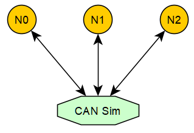

# CAN Bus Simulation Technology

This article assumes the reader already has some knowledge of the CAN protocol, but even if you do not, that is fine. CAN itself is not a complicated protocol from a software point of view. The official specifications contain a lot of material, much of it related to hardware characteristics. As a software engineer, however, the core problem is simply sending and receiving CAN frames.

From a software-definition perspective, the CAN frame structures in AUTOSAR and Linux look like this:

```c
// AUTOSAR
typedef struct {
  uint8_t length;
  Can_IdType id;
  uint8_t *sdu;
} Can_PduType;

// linux
struct can_frame {
    canid_t can_id;  /* 32 bit CAN_ID + EFF/RTR/ERR flags */
    __u8    can_dlc; /* frame payload length in byte (0 .. 8) */
    __u8    __pad;   /* padding */
    __u8    __res0;  /* reserved / padding */
    __u8    __res1;  /* reserved / padding */
    __u8    data[8] __attribute__((aligned(8)));
};
```

One of the key characteristics of a CAN network is broadcast behavior: when a node on the bus transmits a CAN frame, the other nodes on the same bus can all receive it.

Because of that, we can simulate this behavior on Windows or Linux by using sockets. That lets us build a virtual CAN communication environment. Linux already provides [virtual CAN](https://www.pragmaticlinux.com/2021/10/how-to-create-a-virtual-can-interface-on-linux/) by default, which is worth exploring if you are interested. Windows, however, has no equivalent built in, and that is why I implemented my own socket-based CAN simulation scheme.



As shown above, CAN Sim acts as a TCP server, while N0, N1, and N2 are TCP clients. Each node establishes a TCP connection to CAN Sim. When N0 sends a CAN frame, it actually sends the frame data to CAN Sim, and CAN Sim forwards that frame to N1 and N2, thereby emulating CAN broadcast behavior.

This design is not perfect. A UDP broadcast solution would likely be better. But I implemented this before I fully understood UDP broadcast. Even so, it has turned out to be a very practical solution. Over the years, it helped me implement and validate many upper-layer CAN communication modules, including CANTP, DCM, COM, CANNM, and OSEKNM, and it also helped with bootloader development and verification.

In my [ssas-public](https://github.com/autoas/ssas-public) repository, the [CAN Sim implementation](https://github.com/autoas/ssas-public/tools/libraries/Can/utils/can_simulator.c) is open source. It is very small, under 500 lines of code, and worth reading if you are curious.

The client-side implementation is also open source. Its header file [canlib.h](https://github.com/autoas/ssas-public/tools/libraries/Can/include/canlib.h) provides the following APIs:

```c
int can_open(const char *device_name, uint32_t port, uint32_t baudrate);
bool can_write(int busid, uint32_t canid, uint8_t dlc, const uint8_t *data);
bool can_read(int busid, uint32_t *canid /* InOut */, uint8_t *dlc /* InOut */, uint8_t *data);
bool can_close(int busid);
```

At the moment, `canlib` supports the following devices:

* TCP CAN simulator: `device_name = "simulator"`
* UDP multicast CAN simulator v2: `device_name = "simulator_v2"`
* QEMU serial CAN: `device_name = "qemu"`
* [Vector VXL CAN](https://www.vector.com/int/en/products/products-a-z/libraries-drivers/xl-driver-library/): `device_name = "vxl"`
* [Peak CAN](https://www.peak-system.com/): `device_name = "peak"`
* [ZLG CAN](https://www.zlg.cn/can/can/index.html): `device_name = "zlg"`

There are only a handful of APIs. To stay compatible with AUTOSAR, I also wrapped `canlib` with an AUTOSAR-style CAN driver interface. The implementation is [Simulator CAN](../../app/platform/simulator/src/Can.cpp), and the API looks like this:

```c
void Can_Init(const Can_ConfigType *Config);
void Can_DeInit(void);
Std_ReturnType Can_Write(Can_HwHandleType Hth, const Can_PduType *PduInfo);
Std_ReturnType Can_SetControllerMode(uint8_t Controller, Can_ControllerStateType Transition);
void CanIf_RxIndication(const Can_HwType *Mailbox, const PduInfoType *PduInfoPtr);
```

That is enough for this article. For more about how to use `canlib` and the AUTOSAR CAN driver wrapper, stay tuned for follow-up articles.

## Experiment: Sending and Receiving Frames from Python

```sh
# Step 1: In the app tab, build the following programs
D:\repository\ssas-public>scons --app=CanSimulator
D:\repository\ssas-public>scons --lib=AsPy
D:\repository\ssas-public>cp build\nt\GCC\AsPy\AsPy.dll AsPy.pyd

# In the sim tab, start the CAN bus 0 simulator
D:\repository\ssas-public>build\nt\GCC\CanSimulator\CanSimulator.exe 0

# Step 2: In the app tab, start the following Python interactive session.
# This simulates a CAN node N0.
D:\repository\ssas-public>python
Type "help", "copyright", "credits" or "license" for more information.
>>> import os
>>> os.add_dll_directory('C:/msys64/mingw64/bin')
>>> import AsPy
>>> n0 = AsPy.can('simulator', 0)

# Step 3: In the boot tab, start another Python interactive session.
# This simulates another CAN node N1.
D:\repository\ssas-public>python
Type "help", "copyright", "credits" or "license" for more information.
>>> import os
>>> os.add_dll_directory('C:/msys64/mingw64/bin')
>>> import AsPy
>>> n1 = AsPy.can('simulator', 0)

# Step 4: In the sim tab, you should see the following output.
# CAN Sim has detected that both nodes are online.
can socket 104 on-line!
can socket 108 on-line!

# Step 5: Switch to the app tab and run the following Python command.
# Node N0 sends one CAN frame.
>>> n0.write(0x731, bytes(range(8)))
True

# Step 6: In the sim tab, you should see the transmission succeed.
canid=00000731,dlc=08,data=[00,01,02,03,04,05,06,07,] [........] @ 1011.104675 s rel 625132.69 ms

# Step 7: In the boot tab, receive and then send a CAN frame.
>>> n1.read(0x731)
[True, 1841, b'\x00\x01\x02\x03\x04\x05\x06\x07']
# Here you can see that node N1 received the frame with ID 0x731 sent by N0.
>>> n1.write(0x732, bytes(range(8)))
True

# Step 8: In the sim tab, you should see the following output.
canid=00000732,dlc=08,data=[00,01,02,03,04,05,06,07,] [........] @ 1098.185181 s rel 87080.51 ms

# Step 9: Switch back to the app tab and run the following command.
>>> n0.read(0x732)
[True, 1842, b'\x00\x01\x02\x03\x04\x05\x06\x07']
# This shows that node N0 received the frame with ID 0x732 sent by N1.
```

As you can see, the `canlib` library is extremely convenient. With Python, you can access CAN devices and manipulate CAN frame transmission and reception very easily. It is a great way to quickly build CAN-related test cases and host-side tools. Life is short, use Python.