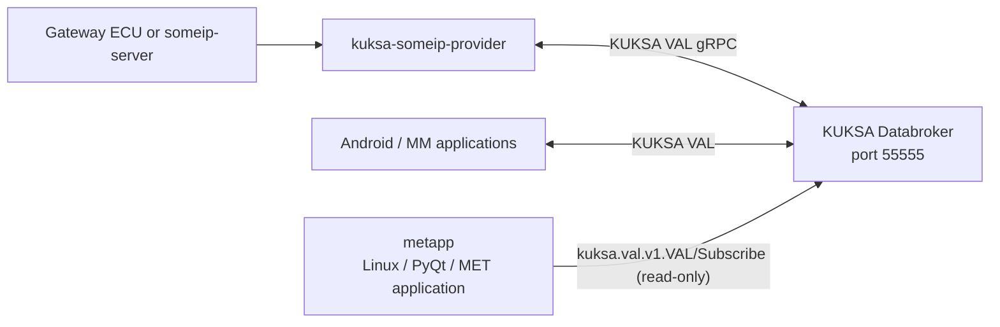
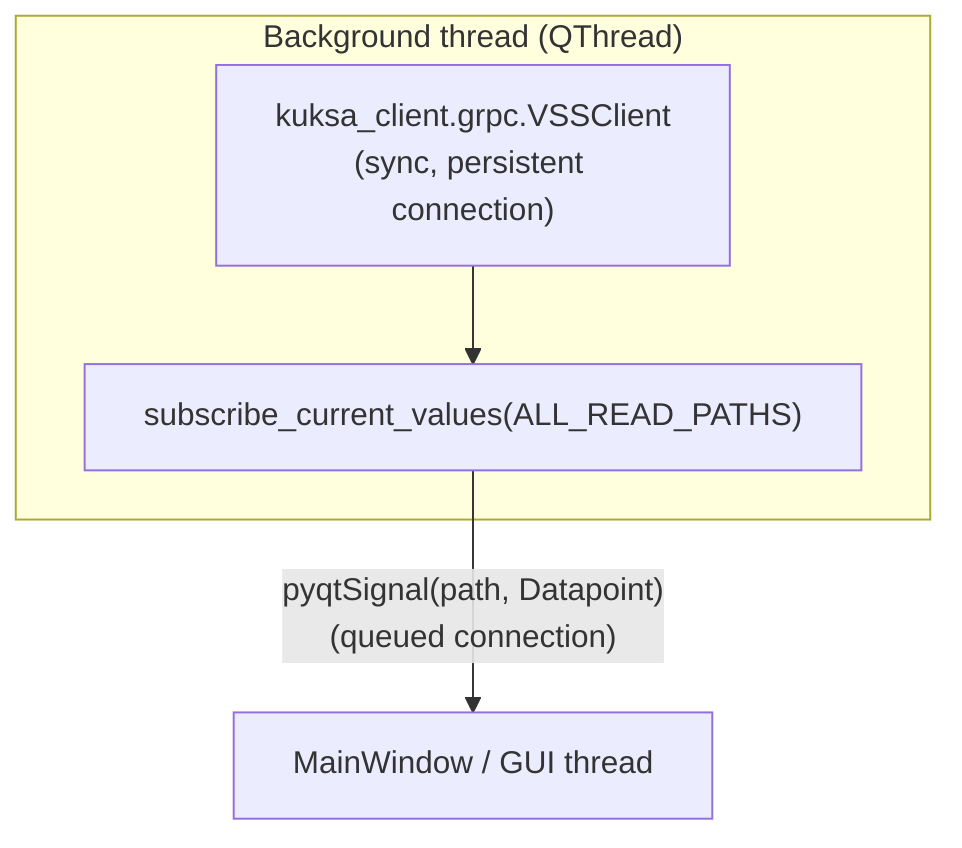

# metapp — PyQt Meter (Instrument Cluster) Application

A design specification for `metapp`, a Linux/PyQt instrument-cluster
application. This is the `MET_UI` component in
[`specs/swarch/SWARCH-000-overview.md`](../specs/swarch/SWARCH-000-overview.md)
§3 (Deployment view): a read-only KUKSA VAL gRPC client that displays
vehicle signals from KUKSA Databroker, in the same role as the Android/MM
application but running natively on Linux.

**Status: implemented.** `metapp/` now implements this design end to end
(§9): the KUKSA subscriber thread, staleness computation, and the gauge/
lamp/gear/fuel widgets are all in place and have been verified against a
real running stack (see §10). This document remains the spec to keep the
implementation aligned with — it follows the same spec-driven approach as
[`automotive_linux/README.md`](../automotive_linux/README.md) and
`autoas-as/src/app/fmw/README.md`.

- [metapp — PyQt Meter (Instrument Cluster) Application](#metapp--pyqt-meter-instrument-cluster-application)
  - [1. Position in the Overall Architecture](#1-position-in-the-overall-architecture)
  - [2. Goals / Non-Goals](#2-goals--non-goals)
  - [3. Technology Stack](#3-technology-stack)
  - [4. Runtime Architecture](#4-runtime-architecture)
    - [4.1 Threading Model](#41-threading-model)
    - [4.2 Reconnection / Degraded Display](#42-reconnection--degraded-display)
  - [5. VSS Signal Mapping (Read)](#5-vss-signal-mapping-read)
  - [6. Data Freshness / Staleness Design](#6-data-freshness--staleness-design)
  - [7. UI Design](#7-ui-design)
    - [7.1 Screen Layout](#71-screen-layout)
    - [7.2 Gear Display Mapping](#72-gear-display-mapping)
    - [7.3 Warning Indicators](#73-warning-indicators)
  - [8. Connection, Configuration \& Containerization](#8-connection-configuration--containerization)
    - [8.1 Standalone (host process)](#81-standalone-host-process)
    - [8.2 Containerized (docker compose)](#82-containerized-docker-compose)
  - [9. Directory Layout](#9-directory-layout)
  - [10. Testing Strategy](#10-testing-strategy)
  - [11. Open Items / Future Extensions](#11-open-items--future-extensions)
  - [12. Trace](#12-trace)

## 1. Position in the Overall Architecture



`metapp` talks to KUKSA Databroker directly over gRPC — it never touches
SOME/IP, vsomeip, or the LKV codec. Those are entirely internal to
`kuksa-someip-provider` (SWARCH-001). `metapp` only needs to know VSS paths,
types, and units (SYS-003), exactly like the Android/MM application.

## 2. Goals / Non-Goals

**Goals**

- Display the mandatory MET signal set from
  [SYS-003](../specs/sys/SYS-003-vss.md) §10 (speed, ESC/ABS error, seatbelt,
  door, airbag, fuel level) plus the remaining standard body/powertrain
  signals that a meter cluster conventionally shows (engine speed, gear,
  parking brake).
- Reflect per-signal data freshness in the UI (§6), since a stalled upstream
  is a real, spec-documented failure mode (SYS-001 timeout column,
  SWARCH-000 §6 `DEGRADED` state).
- Run against the existing `docker-compose` stack, either as a plain host
  process or as its own `metapp` service in the repository-root
  `docker-compose.yml` (§8.2), with no changes required to Databroker, the
  provider, or the ECU/simulator.
- Ship as a container in the same `docker-compose.yml` as the rest of the
  stack, so the whole system — Gateway ECU/simulator, provider, Databroker,
  and the meter cluster — can be brought up with one `docker compose up -d`.

**Non-goals**

- HVAC display and actuation are out of scope. Per SYS-003 §10, "MET-related
  displays" (this app) and "HVAC / Display UIs" are described as distinct
  usage roles with distinct read/write responsibilities; a HVAC panel, if
  built, is a separate application against the same Databroker, not a
  feature of `metapp`.
- No SOME/IP, CAN, or provider-internal concepts (LKV, confidence levels,
  vSomeIP) belong in this codebase — see §1.

## 3. Technology Stack

| Concern | Choice | Why |
|---|---|---|
| GUI toolkit | PyQt6 | Requested by the user; native `QPainter`-based custom gauge widgets |
| Databroker client | [`kuksa-client`](https://github.com/eclipse-kuksa/kuksa-python-sdk) (`kuksa_client.grpc.VSSClient`) | Official Eclipse KUKSA Python SDK; wraps `kuksa.val.v1` gRPC (`metapp` only uses `Subscribe`/`Get`), same API family `automotive_linux/README.md`'s `grpcurl` examples exercise directly |
| Packaging | `pyproject.toml`, a single `metapp` console-script entry point, plus a `Dockerfile` | Runs both as a plain host process and as its own service in the repository-root `docker-compose.yml` (§8.2) |
| Python version | 3.10+ | Matches Ubuntu 24.04 LTS's default `python3` (SYS/automotive_linux prerequisite baseline) |

`kuksa-client` also ships an asyncio client (`kuksa_client.grpc.aio.VSSClient`),
but PyQt6's own event loop is not asyncio-based; §4.1 uses the synchronous
client on a background thread instead of pulling in `qasync`, to keep the
dependency surface small.

## 4. Runtime Architecture

### 4.1 Threading Model



- A dedicated `QThread` opens one `VSSClient` and calls
  `subscribe_current_values()` once, for every path in §5, using the
  underlying `kuksa.val.v1.VAL/Subscribe` streaming RPC — push-based updates,
  no polling loop.
- Each update dict entry is re-emitted as a Qt signal
  (`valueUpdated(str, object)`), which Qt automatically marshals to the GUI
  thread via a queued connection since the emitting thread differs from the
  receiving `QObject`'s thread affinity. The GUI thread never calls into
  gRPC directly.
- A `VehicleState` `QObject` (§9, `models.py`) owns the latest `Datapoint`
  per path plus its locally-computed staleness (§6), and re-emits one
  coalesced `stateChanged` signal the widgets bind to.
- `metapp` is read-only against Databroker (§2 Non-goals), so there is no
  write/actuation path or second `VSSClient` connection to design here.

### 4.2 Reconnection / Degraded Display

`kuksa_client.grpc.VSSClient`'s underlying gRPC channel will drop the
subscription if Databroker restarts or the network path breaks. The worker
thread wraps the subscribe loop in a retry cycle:

1. On `grpc.RpcError` (or the iterator ending), mark every displayed signal
   `STALE`/`UNKNOWN` immediately (§6) rather than waiting for the per-signal
   timeout — a dropped connection is a certain loss of freshness, not a
   guess.
2. Reconnect with a capped exponential backoff (start 1 s, cap 5 s), mirror
   of the provider's `INIT`/`DEGRADED` retry framing in SWARCH-000 §6, scaled
   for a UI client rather than a SOME/IP subscriber.
3. Re-issue `subscribe_current_values()` for the full path set on
   reconnect — the server-streaming RPC has no resume/replay semantics, so
   there is nothing to reconcile beyond re-subscribing.
4. The main window shows a persistent "Databroker disconnected" banner while
   in this state, per SYS-003 §10's guidance to notify rather than silently
   guess.

## 5. VSS Signal Mapping (Read)

`metapp` only ever reads Databroker — see §2 Non-goals. Sourced from
SWARCH-001 §2.3 and SYS-003 §3/§10. All are `Shared`-owned,
server-streamed values; `metapp` never assumes a specific update period, only
that it is one of `SYS-003`'s 50/100/500 ms cycles.

| VSS Path | Type | Cluster Element | Mandatory per SYS-003 §10? |
|---|---|---|---|
| `Vehicle.Speed` | float, km/h | Speedometer | Yes |
| `Vehicle.Powertrain.CombustionEngine.Speed` | float, rpm | Tachometer | No (conventional cluster signal) |
| `Vehicle.Powertrain.Transmission.CurrentGear` | int8 | Gear indicator (§7.2) | No |
| `Vehicle.Chassis.ParkingBrake.IsEngaged` | bool | Parking-brake indicator | No |
| `Vehicle.ADAS.ESC.IsError` | bool | ESC warning lamp | Yes |
| `Vehicle.ADAS.ABS.IsError` | bool | ABS warning lamp | Yes |
| `Vehicle.Cabin.Seat.Row1.DriverSide.IsBelted` | bool | Seatbelt warning lamp | Yes |
| `Vehicle.Cabin.Door.Row1.DriverSide.IsOpen` | bool | Door-open warning lamp | Yes |
| `Vehicle.Cabin.Seat.Row1.DriverSide.Airbag.IsDeployed` | bool | Airbag warning lamp | Yes |
| `Vehicle.Powertrain.FuelSystem.RelativeLevel` | uint8, percent | Low-fuel warning lamp (ON only at 0%) | Yes |

The wildcard Seat/Door/Airbag paths are read at the concrete
`Row1.DriverSide` instance, matching the single instance the provider
currently publishes (SWARCH-001 §2.3); `metapp` does not attempt to discover
other instances.

## 6. Data Freshness / Staleness Design

**This is the one place `metapp` must diverge from a naive "just display the
latest value" client.** `kuksa.val.v1.Datapoint` on the wire carries only a
value and a `timestamp` — the richer `quality`/`confidence`/`source` metadata
described in SYS-003 §7 is produced and consumed *internally* by the
provider (deciding whether to feed at all) but is **not** forwarded into
Databroker: `VehicleStateAdapter`'s feed path (`vehicle_state_adapter.cc`)
simply stops calling `FeedValue` while a signal is stale, leaving the last
value and timestamp frozen in Databroker rather than writing an explicit
`STALE` marker. So from a client's point of view, staleness is entirely
*inferred* from how old `Datapoint.timestamp` is compared to wall-clock time
— there is no field to read it from directly.

`metapp` re-derives staleness using the per-signal timeout values already
defined in [SYS-001](../specs/sys/SYS-001-can-signal.md) §2 (the original
source of each signal's timing), rather than inventing new thresholds:

| VSS Path | Stale after | Unknown/fallback after | Fallback UI behavior |
|---|---:|---:|---|
| `Vehicle.Speed` | 300 ms | 2000 ms | Hold last value, then show `0` |
| `Vehicle.Powertrain.CombustionEngine.Speed` | 150 ms | 2000 ms (same holding rule as Speed) | Needle returns to `0`, fault tint on the gauge |
| `Vehicle.Powertrain.Transmission.CurrentGear` | 150 ms | 2000 ms | Gear readout shows `--` (indeterminate) |
| `Vehicle.Chassis.ParkingBrake.IsEngaged` | 300 ms | 2000 ms | Indicator shows the conservative state (Applied) |
| `Vehicle.ADAS.ESC.IsError` | 300 ms | 2000 ms | Lamp forced ON (fail-safe, matches SYS-001) |
| `Vehicle.ADAS.ABS.IsError` | 300 ms | 2000 ms | Lamp forced ON (fail-safe, matches SYS-001) |
| `Vehicle.Cabin.Seat.Row1.DriverSide.IsBelted` | 300 ms | 2000 ms | Lamp shown as indeterminate (dim/blinking) |
| `Vehicle.Cabin.Door.Row1.DriverSide.IsOpen` | 300 ms | 2000 ms | Lamp shown as indeterminate |
| `Vehicle.Cabin.Seat.Row1.DriverSide.Airbag.IsDeployed` | 300 ms | 2000 ms | Lamp forced ON (fail-safe, matches SYS-001) |
| `Vehicle.Powertrain.FuelSystem.RelativeLevel` | 1500 ms | 3000 ms | Lamp forced ON (fail-safe, matches SYS-001) |

Notes:

- These thresholds are measured against `Datapoint.timestamp` (the value's
  own timestamp, ultimately traceable to the Gateway ECU's send time per
  SWARCH-002 §5), not against "time since the app last received *any*
  message for this path" — a value can go stale in Databroker while the
  gRPC stream itself stays connected (e.g., the provider entering
  `DEGRADED`, SWARCH-000 §6), and `metapp` must catch that case too, not
  only a dropped connection (§4.2).
- This reuses SYS-001's *timeout* column, whose original context is the CAN
  layer, as the best available authoritative per-signal number — SYS-003
  does not restate it and the SOME/IP/Databroker hop adds negligible latency
  next to these margins. This is a deliberate design choice, not a spec
  requirement; if SYS-003 is later extended with its own client-facing
  freshness contract, that supersedes this table.
- No general "2 consecutive valid samples" recovery gating is implemented on
  the `metapp` side: that rule (SYS-003 §7, SWARCH-000 §6) governs when the
  *provider* resumes feeding Databroker. Once `metapp` sees a fresh
  timestamp again, it is by definition a value the provider already decided
  was recovered.

## 7. UI Design

### 7.1 Screen Layout

```text
+----------------------------------------------------------------+
| [ESC] [ABS] [Belt] [Door] [Airbag] [Fuel]  <cluster warning row>|
|                                                                  |
|      ____________              ____________                    |
|     /            \            /            \                   |
|    |              |          |              |                  |
|     \____________/            \____________/                   |
|         TACH                       SPEED                        |
|                                                                  |
|   Gear: [ D ]                                    (P) parking   |
|                                                                  |
| [ Databroker: connected ]                    <status bar>       |
+----------------------------------------------------------------+
```

- Speedometer and tachometer are custom `QWidget` gauges drawn with
  `QPainter` (arc + needle), each bound to one `Vehicle.Speed` /
  `...CombustionEngine.Speed` value plus its staleness flag from §6. The
  title ("TACH"/"SPEED") is drawn below the arc, in the empty 90° gap the
  270° sweep leaves at the bottom, so it never overlaps the arc/ticks.
- The warning row is six fixed icon slots (ESC, ABS, Seatbelt, Door,
  Airbag, Fuel); each lamp has three visual states: off / on (fail
  condition) / indeterminate (stale, per §6's fallback column) — never
  silently reverting to "off" on stale data, since most of these are
  fail-safe signals ("forced ON" per SYS-001; see §7.3 for which).
- Gear is a simple label widget; parking brake is a small static icon.
- The status bar reflects the reconnect state machine from §4.2.

### 7.2 Gear Display Mapping

Reused verbatim from [SYS-003](../specs/sys/SYS-003-vss.md) §6:

| `CurrentGear` | Display |
|---:|---|
| -1 | `R` (Reverse) |
| 0 | `N` (Neutral) |
| 1..6 | `1`..`6` |
| 126 | `P` (Park) |
| 127 | `D` (Drive) |
| any other value, or stale (§6) | `--` |

### 7.3 Warning Indicators

| Lamp | ON condition | Fail-safe display while stale (§6) |
|---|---|---|
| ESC | `Vehicle.ADAS.ESC.IsError == true` | ON |
| ABS | `Vehicle.ADAS.ABS.IsError == true` | ON |
| Seatbelt | `IsBelted == false` | Indeterminate (dim/blink) |
| Door | `IsOpen == true` | Indeterminate (dim/blink) |
| Airbag | `IsDeployed == true` | ON |
| Fuel | `RelativeLevel == 0` | ON |

Fuel is a warning lamp, not a 0-100% gauge: `metapp` does not display the
raw fuel percentage anywhere (removed from §7.1's gear/fuel row), only
whether it has just read exactly `0`. Grouped with ESC/ABS/Airbag's
fail-safe-ON family, not Seatbelt/Door's indeterminate one, since an unknown
fuel level is treated the same as "assume it could be empty."

Implementation note: the fail-safe/indeterminate fallback in the table
above applies from `STALE` onward, not only once a signal reaches
`UNKNOWN` — §7.1's own "off / on / indeterminate" three-state framing reads
as a simpler fresh/not-fresh model than §6's two-threshold table, and §7.3
does not define a separate mid-way STALE appearance for lamps, so
"while stale" here is read to mean the whole not-`OK` range.

## 8. Connection, Configuration & Containerization

| Setting | Source | Default |
|---|---|---|
| Databroker host:port | `--broker-addr` CLI flag, or `METAPP_BROKER_ADDR` env var | `127.0.0.1:55555` standalone; `databroker:55555` when run via docker compose (§8.2) |
| TLS | `--insecure` (default) / `--root-certificates <path>` | Plaintext, matching the existing stack's `grpcurl -plaintext` usage |
| Auth token | `--token <file>` | None (matches `someip_feeder --token`'s optional pattern) |

### 8.1 Standalone (host process)

Runs as a plain host process against the already-published `55555:55555`
port — no compose changes needed for this mode:

```bash
cd metapp
pip install -e .
metapp --broker-addr 127.0.0.1:55555
```

### 8.2 Containerized (docker compose)

`metapp` is a service (`metapp`) in the repository-root
[`docker-compose.yml`](../docker-compose.yml), alongside `databroker`,
`gateway-ecu`/`vehicle-state-server`, and `vehicle-state-provider`. Unlike
those, it is a plain KUKSA VAL gRPC client rather than a SOME/IP
participant, so it needs no fixed IP on `kuksa-net` — only `depends_on:
databroker` and `METAPP_BROKER_ADDR=databroker:55555`.

**Display design: Xvfb + x11vnc inside the container, not host X11
passthrough.** An earlier revision of this design bind-mounted the Docker
host's `/tmp/.X11-unix` and required `xhost +local:docker` — that only
works when `docker compose` runs on the same machine as the display. The
actual target use case is a headless/remote host reached over SSH, where
sharing the host's X server means wiring the container into the SSH
session's per-connection Xauthority cookie, which Docker does not do for
you. Running a self-contained virtual display instead sidesteps that
entirely and works identically whether the host has a display or not:

- `Xvfb` (`start.sh`) provides a virtual X server the PyQt6 `xcb` platform
  plugin renders into — no change needed to the GUI code itself.
- `x11vnc` serves that virtual display as raw VNC on port 5900. A plain VNC
  port needs a native VNC client, though, so:
- `websockify --web=/usr/share/novnc 6080 localhost:5900` bridges browser
  WebSocket connections to that same VNC server and serves noVNC's static
  `vnc.html` from the same port — no native client needed, only a browser.
- `docker-compose.yml` publishes both ports bound to `127.0.0.1` only (not
  the host's LAN interface), and neither `x11vnc` nor `websockify` has
  auth enabled. The only intended access path is an SSH tunnel, which is
  already an authenticated, encrypted channel — see the security note below
  before changing this.

To view it in a browser, from wherever you can `ssh` into the Docker host:

```bash
# from the repository root, on the Docker host
docker compose up -d --build metapp

# from your local machine
ssh -L 6080:localhost:6080 <docker-host>
# then open http://localhost:6080/vnc.html?autoconnect=true in a browser
```

A native VNC client works the same way against port 5900
(`ssh -L 5900:localhost:5900 <docker-host>`, then point the client at
`localhost:5900`) if preferred over the browser.

`restart` is intentionally left unset (no auto-restart) — a crashed GUI
should not respawn in a loop.

**Security note**: because neither port carries authentication in this
setup, anyone who can already reach `127.0.0.1:5900`/`:6080` *on the Docker
host* can view (not control, since nothing else drives input) the cluster
display. This is deliberately scoped to "as safe as SSH access to the host
already is" — do not change either port publish to bind a non-loopback
address without adding auth first (`x11vnc -passwd`/`-rfbauth`, and
`websockify --web-auth`).

## 9. Directory Layout

```text
metapp/
├── README.md
├── pyproject.toml
├── Dockerfile
├── start.sh                   # Xvfb + x11vnc + websockify/noVNC + exec metapp (§8.2)
├── src/metapp/
│   ├── __init__.py
│   ├── main.py                 # CLI/env config (§8), wires everything, runs the event loop
│   ├── vss_paths.py             # VSS path constants + §5/§6/§7.2 tables, as data
│   ├── broker_client.py         # QThread wrapping kuksa_client.grpc.VSSClient;
│   │                             # subscribe loop, reconnect/backoff (§4)
│   ├── vehicle_state.py         # VehicleState QObject: latest Datapoint per
│   │                             # path + staleness computation (§6)
│   └── ui/
│       ├── main_window.py        # layout + wiring to VehicleState's signals
│       ├── gauge.py              # shared QPainter arc-gauge (speed/tach)
│       ├── warning_panel.py      # §7.3 (incl. Fuel lamp)
│       └── gear_fuel_panel.py    # gear/parking-brake row
└── tests/
    ├── test_staleness.py         # §6 threshold table, boundary conditions
    └── test_vss_mapping.py       # §5 path table + §7.2 gear labels
```

## 10. Testing Strategy

- **Unit** (implemented, `tests/`): staleness computation (§6) against
  synthetic timestamps; gear-value-to-label mapping (§7.2); the read-path
  set (§5). Run with `pip install '.[test]' && pytest` — none of this needs
  a live Databroker or a display.
- **Integration** (verified manually against the real stack): a standalone
  script wiring `BrokerClient` + `VehicleState` against a running
  `databroker` correctly received and decoded a live `Vehicle.Speed`
  update end to end (`Freshness.OK`, correct value). The full app was also
  run headlessly (`QT_QPA_PLATFORM=offscreen`) against an unreachable
  broker to confirm the reconnect/backoff loop (§4.2) runs cleanly with no
  crash and no unhandled-exception noise in the logs.
- **Fault injection** (not yet exercised): `docker compose stop
  vehicle-state-provider` (or `gateway-ecu`) against the running `metapp`
  UI to visually verify §4.2/§6's staleness and disconnect handling,
  mirroring SWARCH-002 §6 scenarios 6-7. The `main_window.py` UI update path
  itself has not been visually verified (only imported/constructed
  successfully under the offscreen platform) — worth a real VNC/browser
  look (§8.2) before considering the UI polish done.

## 11. Open Items / Future Extensions

| Target | Item |
|---|---|
| §6 | If SYS-003 is extended with an explicit client-facing freshness contract, replace the SYS-001-derived threshold table with it |
| §7 | Multi-instance Seat/Door/Airbag display, once the provider publishes instances beyond `Row1.DriverSide` (SWARCH-001 §2.3 notes this as a future extension) |

## 12. Trace

- SWARCH-000 §3/§4: deployment view and `MET_UI` component responsibility
  this document elaborates
- SWARCH-001 §2.3: VSS path/type/conversion table read to build §5
- SYS-001 §2: per-signal timeout values read to build §6
- SYS-003 §3, §6, §7, §10: VSS property definitions, gear mapping, quality
  convention, and MET-app usage assumptions this design follows
- SYS-005: verified real VSS catalog paths (used as-is; not re-verified here)
- [`eclipse-kuksa/kuksa-python-sdk`](https://github.com/eclipse-kuksa/kuksa-python-sdk) —
  `kuksa_client.grpc.VSSClient` API (`subscribe_current_values`) this design
  is built on
- `automotive_linux/README.md` — sibling KUKSA VAL client examples
  (`grpcurl`) this design's manual-verification steps mirror
- [`../docker-compose.yml`](../docker-compose.yml) — the `metapp` service
  definition this design's §8.2 describes
