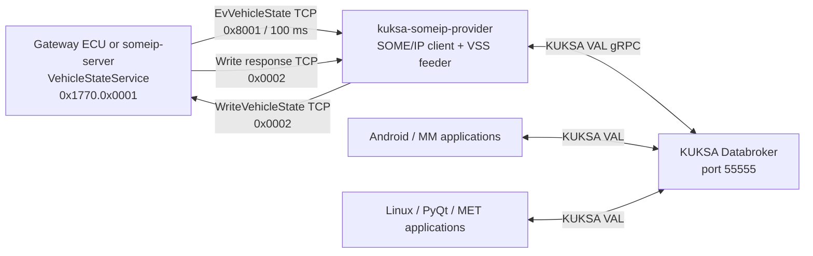

# SWARCH-000: Vehicle Service Overall Architecture

## 1. Purpose

This document defines the logical and deployment architecture of the Linux
Vehicle Service described by SYS-002 and SYS-003.

The implementation keeps the existing KUKSA Databroker and
`kuksa-someip-provider` as the VSS access path. `someip-server` is an
ECU-side simulator and protocol test peer; it is not part of the production
Linux Vehicle Service process. The wiper PoC path (`wiper_poc`,
`wiper_service`, `0x60d0`/`0x6123`) has been retired; see §7.

## 2. Scope and principles

- Gateway ECU state is received as one `EvVehicleState` SOME/IP event carrying
  multiple LKV entries.
- Linux publishes the received values to KUKSA Databroker using the VSS paths
  in SYS-003.
- HVAC writes originate at the VSS actuator path and are sent as one generic
  `WriteVehicleState` SOME/IP method request.
- A successful write response is followed by a state event containing the
  applied value.
- Databroker and the provider remain replaceable infrastructure components.
  Protocol conversion is isolated at the SOME/IP boundary.

## 3. Deployment view

The Docker network remains `kuksa-net`. The existing provider and databroker
containers retain their current roles. The `someip-server` container is
connected to the same network and uses a separate vSomeIP application name
and routing configuration.

## 4. Component responsibilities

| Component | Responsibility |
|---|---|
| Gateway ECU / `someip-server` | Owns vehicle state, offers SOME/IP event and methods, accepts HVAC writes |
| `kuksa-someip-provider` | Subscribes to events, converts values, feeds Databroker, observes actuator targets |
| KUKSA Databroker | VSS value store and gRPC API |
| Android / MM | Reads and writes VSS properties (incl. HVAC actuation) |
| MET UI (`metapp`) | Read-only KUKSA VAL client; displays speed/tach/gear/warning lamps with locally-derived staleness (see SWRS-MET-UI, `metapp/README.md`) |

## 5. Data flow

### 5.1 State distribution

1. The server offers service `0x1770`, instance `0x0001`, version `1.0`.
2. The provider discovers the service, requests event `0x8001`, and subscribes
   to event group `0x0001`.
3. Every 100 ms the server sends a snapshot-style list of LKV entries over TCP.
4. The provider validates key, type, range, timestamp, and quality before
   feeding corresponding Databroker paths.
5. On missing samples, the provider retains the last value and publishes
   `STALE` metadata after the SYS-002/SYS-003 timeout rules apply.

### 5.2 HVAC write

1. A VSS actuator update is received by the provider.
2. The provider validates that the key is one of `0x1006` through `0x100A`.
3. It sends `WriteVehicleState` over TCP with one or more LKV entries.
4. The server validates and atomically applies the supported entries.
5. The response reports per-entry success or failure.
6. On success, the server emits the resulting state in the next event.

## 6. Operational states

The provider exposes the following internal state for diagnostics:

| State | Meaning | Transition to recovery |
|---|---|---|
| `INIT` | vSomeIP or Databroker is not ready | Dependencies become available |
| `ACTIVE` | Events are valid and within freshness limits | Two consecutive valid samples are required after degradation |
| `DEGRADED` | Discovery, subscription, timeout, or validation failure | Re-subscribe and receive two valid samples |
| `STOPPING` | Shutdown is in progress | Process exit |

Three missed event cycles trigger re-subscription. Service Discovery is retried
at one-second intervals. Drops, out-of-order messages, delay, and recovery
failure are audit-log events.

## 7. Migration boundary (completed)

The provider was previously coupled to `wiper_poc` and the `0x60d0`/`0x6123`
interfaces. Migration to VehicleState followed these steps:

1. Add a generic LKV codec and VehicleState adapter beside the wiper adapter.
2. Add configuration selecting `vehicle_state` versus `wiper` mode.
3. Verify VehicleState end to end with the new server.
4. Retire the wiper mode.

`wiper_poc`, `wiper_service`, and the wiper-mode `provider`/`someip-server`
deployment directories have been removed from the source tree; the
`someip_feeder` binary now runs the VehicleState adapter unconditionally
(no more `ADAPTER_MODE` selection). This was done on explicit user
instruction before SWARCH-002 §6 scenarios 6-7 (re-subscription after
missed cycles, recovery after two valid samples) had been verified;
scenarios 1-5 and both HVAC write and read paths were verified end to end
first. Scenarios 6-7 remain to be exercised against the current
implementation; see §9.

## 8. Traceability

- CAN signal origin: SYS-001
- SOME/IP IDs and timing: SYS-002
- VSS paths, units, quality, and update modes: SYS-003
- CDC-F rulings driving TCP-only transport, quality quintet, 2-sample
  recovery, confidence levels, and Fan conversion: SYS-004
- Implementation: `vehicle_service/workspace/kuksa-someip-provider/src/examples/vehicle_state_service`
  (server simulator) and `.../src/someip_feeder` (provider adapter); and, for
  the real (non-simulator) Gateway ECU, `autoas-as/src/app/fmw` (see its
  `README.md` and SWARCH-002 §1)
- AAOS VHAL consumer (Android side of the Databroker): SWARCH-003 and
  `aaos16/patches/0002-vhal-proxy-server-kuksa.patch`
- MET UI requirements and implementation: SWRS-MET-UI, `metapp/` (see its
  `README.md` for the threading model, staleness derivation, and UI design
  this client-side box in §3's deployment view expands into)

## 9. Open Item Tracking

| ID | Target | Open Item | Priority | Status |
|---|---|---|---|---|
| SWARCH-000-R-001 | SWARCH-001 / SWARCH-002 | Fix the initial Seat/Door/Airbag wildcard instance to `Row1.DriverSide` | High | Done |
| SWARCH-000-R-002 | SWARCH-000 §7 | Define an objective wiper-mode retirement criterion in place of "existing PoC users have migrated" | Medium | Done |
| SWARCH-000-R-003 | SWARCH-000 §7 | Retire wiper mode (`wiper_poc`, `wiper_service`, wiper-mode `provider`/`someip-server`) | High | Done (by explicit user instruction; SWARCH-002 §6 scenarios 6-7 not yet verified against the retired-wiper deployment) |
| SWARCH-000-R-004 | SWARCH-002 §6 | Verify scenarios 6-7 (re-subscription after 4 missed cycles, recovery after 2 valid samples) against the current provider | Medium | Open |
| SWARCH-000-R-005 | SYS-002 §5.2 / SWARCH-002 | Real Gateway ECU (`autoas-as/src/app/fmw`) uses the revised fixed-length LKV schema; `someip-server` mock still implements the original variable-length TLV (kept, `profiles: ["mock"]` in the repository-root `docker-compose.yml`, moved there from `automotive_linux/vehicle_service/docker-compose.yml`). The Linux provider (`someip_feeder`) now has a second codec, `fixed_lkv_codec.{h,cc}`, verified byte-for-byte against captured wire traffic from a real running Gateway ECU (event/snapshot decode and write request/response round trip). `docker-compose.yml`'s new `gateway-ecu` service runs the real Gateway ECU + webcan. Transport-level SOME/IP-SD interop between vsomeip (Linux) and autoas-as's native SomeIp stack is confirmed (service availability). Was open: `EvVehicleState` eventgroup subscription did not complete in this docker-compose bridge-network environment (vsomeip `create_eventgroup_entry: local reliable port is zero`); reproduces identically against the original mock server too, so it is an existing vsomeip/Docker-networking issue unrelated to the schema migration -- see `autoas-as/src/app/fmw/README.md` §11.3 for the diagnosis and next steps; resolved: the cause was the vSOMEIP version and the UDP ports that had to be opened, not the schema migration or the bridge network itself; the subscription completes and the provider feeds Databroker (verified by the AAOS VHAL end-to-end test of SWARCH-003) | Medium | Done |
| SWARCH-000-R-006 | SWARCH-003 | AAOS VHAL bridge implemented and verified end to end (webcan to KUKSA to VHAL, HVAC write round trip, Databroker restart, STALE ignored). Not yet verified: multi-instance Seat/Door/Airbag, long-run stability | Medium | Done (initial scope) |
