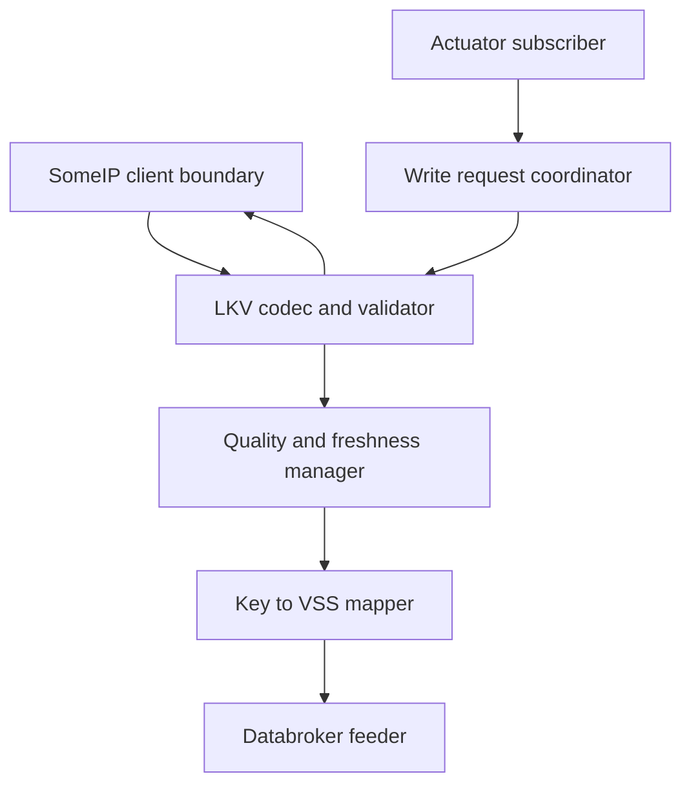

# SWARCH-001: Linux Vehicle Service

## 1. Logical decomposition



The provider process owns the conversion and policy logic. The Databroker
feeder remains responsible for KUKSA VAL/gRPC interaction, and the actuator
subscriber remains responsible for observing target values. Neither component
should know VehicleState SOME/IP IDs or wire offsets.

## 2. Interfaces

### 2.1 Inbound event

`EvVehicleState` is received on service `0x1770`, instance `0x0001`, event
`0x8001`, event group `0x0001`, using TCP. The event is a complete list of
available state entries (the generic LKV format, SYS-002 §5.2).

### 2.2 Outbound methods

- `GetVehicleStateSnapshot`: `0x0001`, TCP. Returns the current LKV list.
- `WriteVehicleState`: `0x0002`, TCP. Accepts HVAC write entries and returns
  an acknowledgement with the applied result.

Requests must carry the service's major version (1) in the SOME/IP header's
interface version field, per SYS-002 §5.1.1. vsomeip does not do this on its
own — `runtime::create_request()` leaves the field at 0 — so the client sets
it explicitly (`someip_client.cc::SendRequest()`); without it the Gateway ECU
drops every request with no response at all.

### 2.3 Databroker mapping

| Key | Databroker path | Conversion |
|---:|---|---|
| `0x1001` | `Vehicle.Speed` | float, km/h |
| `0x1002` | `Vehicle.Powertrain.CombustionEngine.Speed` | float, rpm |
| `0x1004` | `Vehicle.Powertrain.Transmission.CurrentGear` | int8; SOME/IP bool is derived into gear `-1` for Reverse, not published as a proprietary boolean (path verified per SYS-005) |
| `0x1005` | `Vehicle.Chassis.ParkingBrake.IsEngaged` | bool |
| `0x1006` | `Vehicle.Cabin.HVAC.IsAirConditioningActive` | bool; vehicle-wide, not per-station (path verified per SYS-005) |
| `0x1007` | `Vehicle.Cabin.HVAC.Station.Row1.Driver.Temperature` | float, degC |
| `0x1008` | `Vehicle.Cabin.HVAC.Station.Row1.Driver.FanSpeed` | uint8; `round(level * 100 / 7)` percent |
| `0x1009` | `Vehicle.Cabin.HVAC.Station.Row1.Driver.IsDefrosting` | bool; custom overlay path, requires the databroker to be started with `vehicle_service/databroker/vss_fmw_overlay.json` (SYS-005 section 5) |
| `0x100A` | `Vehicle.Cabin.HVAC.Station.Row1.Driver.AirDistribution` | mode to `UP/MIDDLE/DOWN` |
| `0x100C` | `Vehicle.ADAS.ESC.IsError` | bool |
| `0x100D` | `Vehicle.ADAS.ABS.IsError` | bool |
| `0x100E` | `Vehicle.Cabin.Seat.*.*.IsBelted` | bool; instance fixed to `Row1.DriverSide` |
| `0x100F` | `Vehicle.Cabin.Door.*.*.IsOpen` | bool; instance fixed to `Row1.DriverSide` |
| `0x1010` | `Vehicle.Cabin.Seat.*.*.Airbag.IsDeployed` | bool; instance fixed to `Row1.DriverSide` |
| `0x1011` | `Vehicle.Powertrain.FuelSystem.RelativeLevel` | uint8, percent |

The wildcard entries use `Row1.DriverSide` as the initial configured instance
(SYS-002 / SYS-003), applied uniformly to Seat, Door, and Airbag since they
share the same bit position in SYS-001. The codec remains capable of carrying
multiple entries; publishing additional instances is a future extension.

`0x1009` is the only path here that is not in the standard VSS catalog. It is
registered by the FMW overlay the databroker loads through its
comma-separated `--vss` list. This matters for the write direction as well:
`kuksa.val.v1`'s `Subscribe` rejects its *entire* request when any single
requested path is unknown, so running the provider against a databroker
without the overlay disables actuation for **all five** HVAC keys, not just
defrost. `SUBSCRIBE_ACTUATORS` in `vehicle_state_adapter.cc` therefore
lists all of `0x1006..0x100A` and depends on the overlay being present.

## 3. LKV codec contract

The codec is the only module that knows the binary payload layout. The logical
model is:

```text
LkvMessage {
  uint16 schema_version
  uint16 entry_count
  LkvEntry entries[entry_count]
}

LkvEntry {
  uint16 key_id
  uint8  value_type
  bytes  value
  uint8  quality       // OK=0, INVALID=1, STALE=2
  uint8  confidence    // 0=unknown, 1=low, 2=medium, 3=high
  uint64 timestamp_ms
  uint32 age_ms
  string source
}
```

All multi-byte fields are little-endian. `value_type` is `bool`, `uint8`,
`int8`, `float32`, or UTF-8 string with the lengths defined in SYS-002. The
message has a maximum of 16 entries and a maximum source length of 32 bytes.
The codec rejects truncated lengths, non-zero reserved fields, and malformed
values before they reach the VSS mapper.

## 4. Validation and quality policy

- Unknown keys are rejected in write requests and logged in received events.
- Type and range violations result in `INVALID`; they never overwrite a last
  valid Databroker value.
- Older timestamps are logged as out-of-order and do not replace newer data.
- Event age is computed from the receive clock and the transmitted timestamp.
- A value remains available while stale, but its quality metadata becomes
  `STALE`.
- Recovery is announced only after two consecutive valid samples.
- Confidence uses four levels: `0=Unknown/Not-assessed`, `1=Low (40%)`,
  `2=Medium (60%)`, and `3=High (100%)`. SYS-003's `timestamp`, `freshness`,
  and `source` metadata are populated from the LKV entry and receive clock.
- Fan level `0..7` is converted to VSS percent with
  `round(level * 100 / 7)`; VSS writes are rounded to the nearest level.
- The latest cache is sampled for VSS publication at each path's configured
  period: 50 ms, 100 ms, or 500 ms as specified by SYS-003.

## 5. Implementation status

The minimal implementation plan (generic LKV codec and constants, a
VehicleState adapter, a `vehicle_state` provider configuration with the
SYS-002 IDs) is complete, and the wiper PoC path has since been retired
(SWARCH-000 §7): `someip_feeder` now runs the VehicleState adapter
unconditionally. SWARCH-002 §6 scenarios 1-5 and both the HVAC read and
write paths are verified end to end; scenarios 6-7 (re-subscription after
missed cycles, recovery after two valid samples) remain open (SWARCH-000
§9, SWARCH-000-R-004).

## 6. Trace

- SYS-001: origin of the CAN signals underlying every mapped key
- SYS-002: SOME/IP service, event, method, and LKV payload contract this
  module consumes
- SYS-003: Databroker path, unit, and quality contract this module publishes
- SYS-004: CDC-F rulings finalizing the quality quintet, 2-sample recovery,
  confidence levels, and Fan conversion applied in §4
- SYS-005: verified real VSS catalog data backing the paths in §2.3
- SWARCH-000: deployment view and component responsibilities
- SWARCH-002: server-side counterpart offering the consumed contract