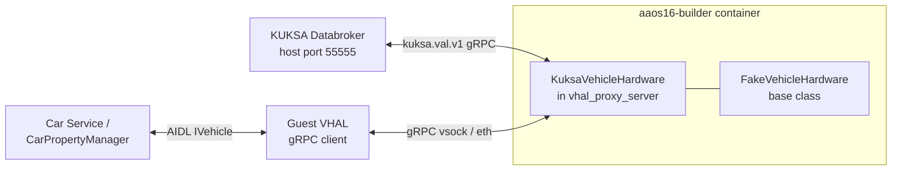

# SWARCH-003: AAOS VHAL to KUKSA Bridge

## 1. Purpose

This document defines how the Android Automotive OS 16 Vehicle HAL (VHAL)
consumes the VSS properties of SYS-003 from the KUKSA Databroker. It realizes
the "Android / MM applications" box of SWARCH-000 §3 for an AAOS guest.

The reference platform is Cuttlefish `aosp_cf_x86_64_auto`. The Cuttlefish
guest VHAL (`android.hardware.automotive.vehicle@V3-cf-service`) is a gRPC
client of the host-side `vhal_proxy_server`, which owns the property store.
The bridge is therefore placed inside `vhal_proxy_server`; the guest image,
SELinux policy and VINTF manifest are unchanged.

## 2. Deployment view

- `KuksaVehicleHardware` derives from `FakeVehicleHardware`. Properties that
  are not bound to a VSS path (power, users, `INFO_*`, ...) keep their fake
  behavior, so Car Service still gets every property it requires at boot.
- The Databroker is reached through the host-published port. The
  `aaos16-builder` container does not join `kuksa-net`; the address comes from
  `KUKSA_ADDR` (default in `aaos16/docker-compose.yml`:
  `host.docker.internal:55555`). When `KUKSA_ADDR` is unset the plain fake
  VHAL is used.

## 3. Property mapping

The driver is on the left: Seat/Door/Window instance `Row1.DriverSide` maps to
`ROW_1_LEFT` (`FRONT_WINDSHIELD` for the defroster). Mapping code:
`KuksaMapping.{h,cpp}`.

| VSS path (SYS-003) | Direction | VHAL property (area) | Conversion |
|---|---|---|---|
| `Vehicle.Speed` | VSS to VHAL | `PERF_VEHICLE_SPEED` (global) | km/h to m/s |
| `Vehicle.Powertrain.CombustionEngine.Speed` | VSS to VHAL | `ENGINE_RPM` (global) | none (rpm) |
| `Vehicle.Chassis.ParkingBrake.IsEngaged` | VSS to VHAL | `PARKING_BRAKE_ON` (global) | bool |
| `Vehicle.Cabin.HVAC.IsAirConditioningActive` | both | `HVAC_AC_ON` (`ROW_1_LEFT`) | bool |
| `...Row1.Driver.Temperature` | both | `HVAC_TEMPERATURE_SET` (`ROW_1_LEFT`) | degC; writes clamped to 16.0..30.0 |
| `...Row1.Driver.FanSpeed` | both | `HVAC_FAN_SPEED` (`ROW_1_LEFT`) | percent `p` to level `round(p*7/100)`; level `l` to `round(l*100/7)` |
| `...Row1.Driver.AirDistribution` | both | `HVAC_FAN_DIRECTION` (`ROW_1_LEFT`) | `UP`=FACE(0x1), `DOWN`=FLOOR(0x2), `MIDDLE`=FACE_AND_FLOOR(0x3); other bit patterns (DEFROST) are rejected on write |
| `...Row1.Driver.IsDefrosting` | both | `HVAC_DEFROSTER` (`FRONT_WINDSHIELD`) | bool |
| `Vehicle.Cabin.Seat.Row1.DriverSide.IsBelted` | VSS to VHAL | `SEAT_BELT_BUCKLED` (`ROW_1_LEFT`) | bool |
| `Vehicle.Cabin.Door.Row1.DriverSide.IsOpen` | VSS to VHAL | `DOOR_POS` (`ROW_1_LEFT`) | bool to 0 / 1 |
| `Vehicle.Cabin.Seat.Row1.DriverSide.Airbag.IsDeployed` | VSS to VHAL | `SEAT_AIRBAGS_DEPLOYED` (`ROW_1_LEFT`) | true sets `VehicleAirbagLocation::FRONT` (0x02) |
| `Vehicle.Powertrain.FuelSystem.RelativeLevel` | VSS to VHAL | `FUEL_LEVEL` (mL), `FUEL_LEVEL_LOW` | `FUEL_LEVEL = level/100 * 15000 mL` (`INFO_FUEL_CAPACITY` of the fake config); `FUEL_LEVEL_LOW` is true only at 0 % |
| `Vehicle.Powertrain.Transmission.CurrentGear` | VSS to VHAL | `GEAR_SELECTION`, `CURRENT_GEAR` (global) | -1 REVERSE, 0 NEUTRAL, 1..6 GEAR_1..GEAR_6, 126 PARK, 127 DRIVE |
| `Vehicle.ADAS.ESC.IsError`, `Vehicle.ADAS.ABS.IsError` | not connected | none | No equivalent standard VHAL property; intentionally not exposed |

## 4. Behavior

### 4.0 Temperature display unit

SYS-003 temperatures are degC, but the fake VHAL defaults
`HVAC_TEMPERATURE_DISPLAY_UNITS` to `FAHRENHEIT`, which made the AAOS HVAC bar
show the value in degF. `KuksaVehicleHardware` sets it to `CELSIUS` at start.
It is a plain VHAL property, so the user can still change it at run time.

### 4.1 State distribution (VSS to VHAL)

1. On start, and after every connection loss, the bridge checks which mapped
   paths exist in the Databroker and subscribes to those (`kuksa.val.v1.VAL`
   `Subscribe`, `FIELD_VALUE`). Missing paths are logged and skipped, since an
   unknown path would fail the whole subscription.
2. The Databroker delivers the current values first, then changes.
3. Each value is validated against the type and range of SYS-003 §3 and
   written to the property store with status `AVAILABLE`. A rejected value is
   logged and the last valid value is kept (SYS-003 §7.1).
4. Connection loss is retried every second and the subscription is rebuilt.

### 4.2 HVAC write (VHAL to VSS)

1. `setValues` on a bound HVAC property converts the value and sets the
   Databroker actuator target (`FIELD_ACTUATOR_TARGET`). The provider then
   follows the flow of SWARCH-000 §5.2.
2. The VHAL store is not modified by the write. It changes only when the state
   comes back through the subscription (SYS-003 §9).
3. If the state does not equal the requested value within 3 s, a property set
   error event (`TRY_AGAIN`) is raised. There is no retry (SYS-003 §10).
4. Invalid values are answered `INVALID_ARG`; a Databroker that is not
   connected is answered `TRY_AGAIN`; a failed Databroker `Set` is answered
   `INTERNAL_ERROR`.

### 4.3 Quality metadata

VHAL has no per-property quality attribute, so SYS-003 §7 metadata is reduced:

| VSS quality | VHAL result |
|---|---|
| `OK` | value stored, `AVAILABLE` |
| `STALE` | ignored; the last value stays `AVAILABLE` |
| `INVALID` | not stored; the last valid value is kept |

`confidence`, `source` and `freshness` are not propagated; they are not
visible through the `kuksa.val.v1` value API either. The consequence for
SWRS-APP-002 is recorded in SWRS-Android-VehicleApp.

## 5. Verification

- Unit test of the conversion rules: `device/google/cuttlefish/host/commands/vhal_proxy_server/kuksa/test/mapping_test.cpp`.
- End-to-end test: `aaos16/tests/kuksa_vhal_e2e.py` injects CAN signals with
  webcan and compares KUKSA with the values read through
  `cmd car_service get-property-value`, then checks the HVAC write path.

## 6. Traceability

- VSS paths, units, quality, update contract: SYS-003
- Provider and Databroker side: SWARCH-000, SWARCH-001
- Requirements: SWRS-Android-VehicleApp
- Source: `aaos16/patches/0002-vhal-proxy-server-kuksa.patch` (applied to
  `device/google/cuttlefish`)
